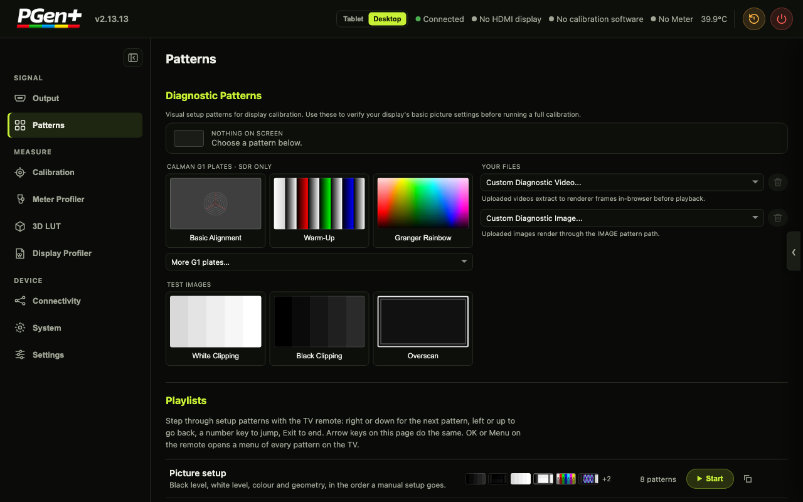
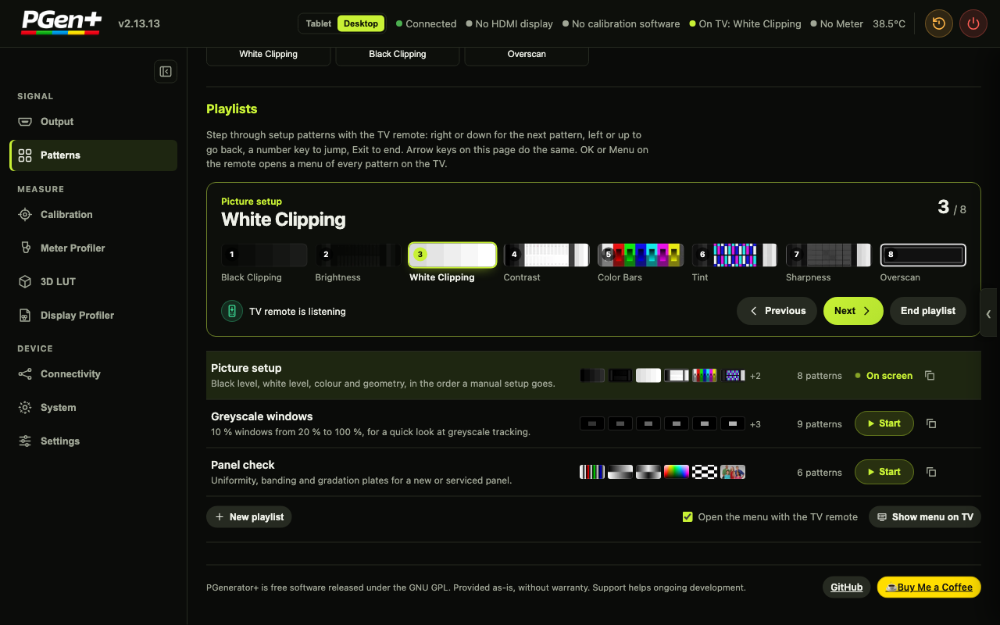
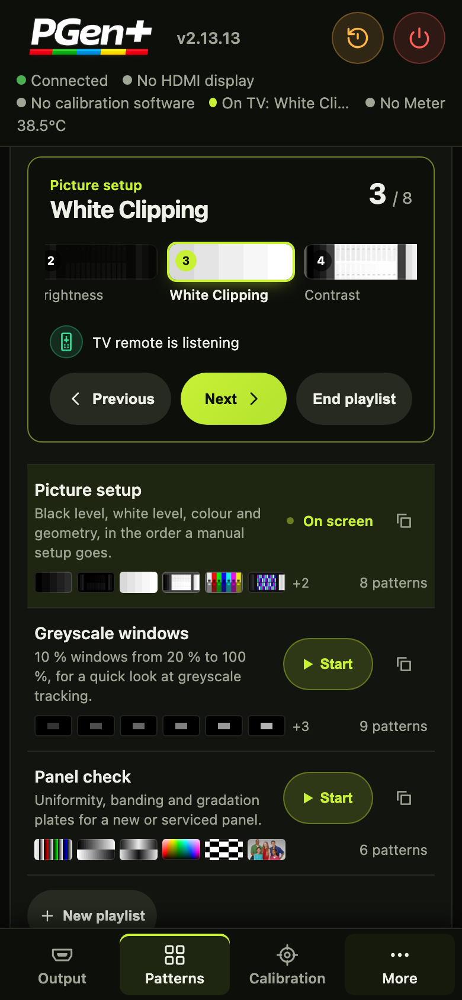
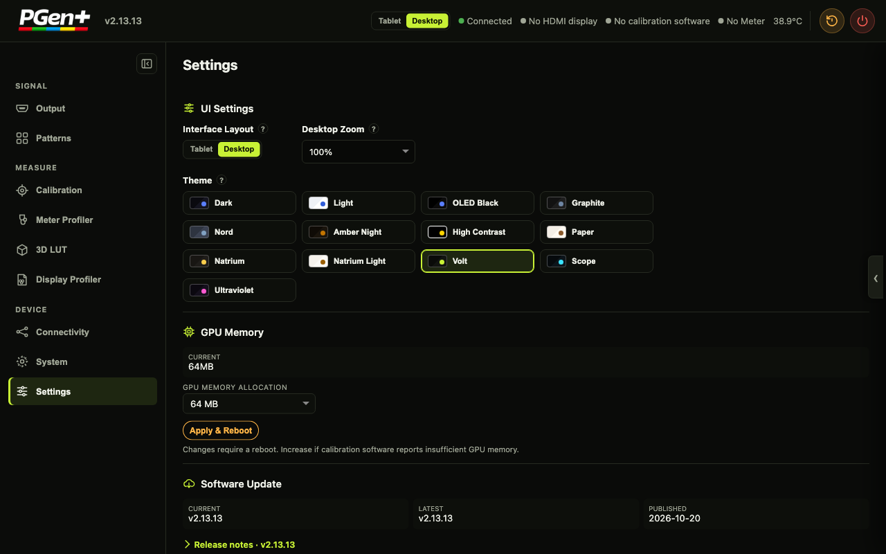
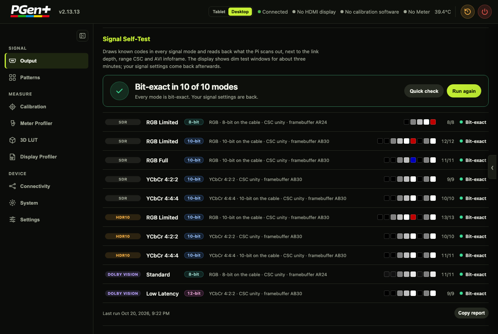

<p align="center">
  
</p>

<h3 align="center">A Raspberry Pi 4 HDMI pattern generator for display calibration that is bit-exact, fast and quiet in daily use</h3>

<p align="center">
  <a href="https://github.com/BlackJoker90/PGenerator-Plus/releases/latest"></a>
  
  
  <a href="COPYING"></a>
</p>

<p align="center">
  <a href="#why-this-fork">Why this fork</a> ·
  <a href="#at-a-glance-fork-vs-original">Fork vs. original</a> ·
  <a href="#get-started">Get started</a> ·
  <a href="#calibration-software-compatibility">Calman &amp; co.</a> ·
  <a href="#reference">Reference</a> ·
  <a href="https://buymeacoffee.com/fabioelia9r">☕ Support</a>
</p>

<p align="center">
  
</p>

---

## Why this fork

This is **BlackJoker90's fork** of [BigShoots/PGenerator-Plus](https://github.com/BigShoots/PGenerator-Plus). It branched from upstream 2.12.1 in September 2026 and has had **115+ commits and 24 releases** since then (2.12.2 → 2.13.x). Upstream has nothing newer that the fork lacks.

Everything the original does is still here: patterns over TCP for Calman, ColourSpace, HCFR and Resolve; on-Pi meter workflows; LG AutoCal; profile building. The fork's focus is the **signal on the HDMI cable** and the **day-to-day experience**:

<table>
<tr>
<td width="50%" valign="top">

### 🎯 Bit-exact output
10-bit pattern codes reach the GPU **without 8-bit quantisation**. **RGB Limited is bit-exact**: a patched vc4 module skips the kernel's compression CSC. HDR10/HLG at 12 bpc goes out as bit-exact 10 bpc instead of crashing the renderer. **8-bit patterns on a 10 bpc link** go out as exactly code × 4 (126 → 504), in SDR, HDR10 and LLDV. The G1 Brightness and Contrast plates switch to **10-bit steps** (0–95, 928–1023) on a 10 bpc link. Scanout readback on the Pi checks the codes; nobody has to eyeball them.

</td>
<td width="50%" valign="top">

### ⚡ Faster signal switching
Changing signal mode takes **~3.5–4.5 s instead of ~10 s**. Format changes go into one atomic modeset, and signal settings are applied in place where possible. The link stays RGB until the renderer is up.

</td>
</tr>
<tr>
<td valign="top">

### 🎛️ Calman that just works
The UPGCI handshake now has proper ACKs and the settings format Calman actually parses. `GET_SETTINGS` works. Codes are rounded to the output depth, with a notice when a code is not exact. YCbCr 4:2:0 requests are refused cleanly with a NAK instead of breaking the link. The Portrait Displays **G1 specialty patterns** are rendered on the Pi.

</td>
<td valign="top">

### 🌈 Dolby Vision, fixed
Low Latency DV renders at **12 bpc** and really switches the TV into DV, with pattern codes sent at 10 bit. Leaving DV signals "DV off" properly and gives back the format, range and depth you had before DV, and the SDR colorimetry. Calman DV consistently runs as standard DV.

</td>
</tr>
<tr>
<td valign="top">

### 🔌 Hotplug-safe
Without a display, the renderer waits instead of failing. The UI says so in a banner, and your saved mode is kept. After a hotplug the screen shows black instead of grey or a text console. Before a reboot or power-off, the HDMI link is handed back as plain RGB.

</td>
<td valign="top">

### 🖥️ A reworked Web UI
**13 colour themes** (dark, light, OLED, Natrium, the lime Volt …) and workspace navigation. The UI shows the measured HDMI link depth and clock. It is served compressed with an ETag, pauses polling in hidden tabs and uses its own dialogs instead of browser pop-ups. Toasts appear only for warnings and errors.

</td>
</tr>
<tr>
<td valign="top">

### 📦 Safer OTA updates
Updates come from **this fork's releases**. The dialog shows the release notes and download progress. You can **reinstall or roll back** to an earlier release. Packages are about **20 % smaller** (stripped binaries, no duplicate files, unused Python modules dropped). Update checks are cached (gentle on the GitHub API), and cross-site requests to the WebUI are refused.

</td>
<td valign="top">

### 🧹 Small things that add up
mDNS answers AAAA queries with an NSEC record, so clients do not wait for an IPv6 address that never comes. `/api/lg/status` answers in milliseconds instead of ~4 s. The boot splash shows once, early. **Download Logs** replaces the old log upload.

</td>
</tr>
<tr>
<td valign="top">

### 🧪 Signal self-test
One button in **System** runs ten signal modes (SDR RGB Limited/Full and YCbCr 4:2:2/4:4:4, HDR10 RGB Limited and YCbCr 4:2:2/4:4:4, Dolby Vision Standard and Low Latency). In each mode it draws known codes, **reads back what the Pi scans out** and checks the link depth and AVI infoframe. Your signal settings come back afterwards; a quick check covers three modes in about 40 s.

</td>
<td valign="top">

### 📺 Pattern menu and playlists on the TV remote
Press **OK or Menu on the TV remote** and a menu of every pattern appears on the TV: G1 plates, test images and playlists as thumbnails. Arrows move, OK shows the pattern, left/right step on, Back returns to the menu. No phone needed. It dims itself in HDR and Dolby Vision and closes after ten idle minutes (OLED). Playlists step the same way: right or down for next, left or up for back, a number key to jump, Exit to end. Three built-in playlists (Picture setup, Greyscale windows, Panel check), plus your own from G1 plates, test images, uploads and APL windows. A deck on the page shows where you are.

</td>
</tr>
</table>

## At a glance: fork vs. original

| | Original ([BigShoots](https://github.com/BigShoots/PGenerator-Plus) 2.12.1) | **This fork (2.13.x)** |
|---|---|---|
| 10-bit pattern codes | quantised through 8 bit on the way to the GPU | **sent at full 10-bit precision** |
| RGB Limited output | kernel compression CSC after the framebuffer | **bit-exact** (patched vc4, verified by scanout readback) |
| HDR10 / HLG at 12 bpc | renderer crashed | bit-exact 10 bpc |
| Signal-mode switch | ~10 s | **~3.5–4.5 s** |
| Low Latency Dolby Vision | TV did not switch into DV | 12 bpc, TV switches into DV |
| Calman UPGCI | settings replies Calman could not parse | ACK + parseable settings, `GET_SETTINGS` |
| Calman YCbCr 4:2:0 request | no defined answer | clean NAK, current format kept, WebUI notice |
| Calman G1 specialty patterns | – | rendered on the Pi, also in the WebUI |
| No display connected | renderer started anyway | waits for a display, banner in the UI, saved mode kept |
| WebUI themes | dark / light / system | **13 themes** incl. Natrium dark & light and Volt, Scope, Ultraviolet |
| HDMI link readout | – | measured link depth and clock |
| OTA | latest release only | release notes, progress, **reinstall / rollback**, ~20 % smaller packages |
| Self-test of the HDMI output | – | **built in**: scanout readback, link depth and AVI per mode |
| Pattern playlists | – | **stepped with the TV remote** (HDMI-CEC), own playlists |
| On-screen pattern menu | – | **every pattern on the TV**, picked with the remote |
| Popups | success and error toasts | warnings and errors only |

> The left column describes upstream behaviour as stated in the fork commits that changed it. Run `git log origin/main..main` in a clone with both remotes for the full list.

## Screenshots

<table>
<tr>
<td width="68%" valign="top"></td>
<td width="32%" rowspan="3" valign="top"></td>
</tr>
<tr>
<td align="center"><sub>Playlists: the deck follows the TV remote; Start, duplicate or edit from the library</sub></td>
</tr>
<tr>
<td valign="top"><br/><p align="center"><sub>Settings: 13 themes, GPU memory, OTA update and backup in one place</sub></p></td>
</tr>
<tr>
<td colspan="2" valign="top"><br/><p align="center"><sub>Signal self-test, right below Display Settings: every mode read back from the scanout on a real Pi 4, bit-exact in 10 of 10</sub></p></td>
</tr>
</table>
<p align="center"><sub>Top right: the same playlists on a phone, with a bottom tab bar</sub></p>

---

## Get started

### New install: flash the image

1. Download the newest release that has image parts, from [Releases](https://github.com/BlackJoker90/PGenerator-Plus/releases) (`PGenerator_Plus_vX.Y.Z_pi4.img.xz.001` and `.002`).
   Image releases are rare by design. Most releases are OTA-only, so grab the latest image and update from there.
2. Join the parts and flash:
   - **Windows:** open `.001` with [7-Zip](https://www.7-zip.org/) to get the `.img`, then flash it with [Balena Etcher](https://etcher.balena.io/) or [Rufus](https://rufus.ie/).
   - **macOS / Linux:** `cat PGenerator_Plus_*_pi4.img.xz.0* > pgen.img.xz`, then flash `pgen.img.xz` with [Raspberry Pi Imager](https://www.raspberrypi.com/software/). Imager reads `.xz` directly.
   - Use a microSD card or USB stick of at least 8 GB.
3. Boot the Pi and connect to it, using one of the methods below.
4. Open **`http://pgenerator.local`** (or the Pi's IP address).
5. Go to **Settings → Software Update → Check for Updates** to move to the newest OTA release.

<details>
<summary><b>Connection methods (Bluetooth PAN, Wi-Fi AP, Ethernet)</b></summary>

- **Bluetooth PAN:** pair with the Pi, then join its PAN in Windows settings.
  <p align="left">
    
    
    
    
    
  </p>
- **Wired PAN:** Ethernet cable directly between your computer and the Pi.
- **Wired LAN:** Pi on your router or switch.
- **Wireless PAN:** join the Pi's access point (SSID `PGenerator`, password `PGenerator`).
  <p align="left"></p>
- **Wireless LAN:** join your own Wi-Fi from **Connectivity** in the Web UI, after connecting once by one of the methods above.

</details>

### Coming from the original project?

OTA updates stay within one `MAJOR.MINOR` family. 2.13 needs a new kernel module, so a Pi on upstream 2.12.x cannot update to the fork over the air. To switch:

1. Export your settings with **Export System Settings** in the Web UI.
2. Flash the latest fork image (see above).
3. Import the backup, then use **Check for Updates** to reach the newest 2.13.x.

From then on the Pi follows this fork's releases. The update source is `usr/share/PGenerator/update-channel`, and an `update_repo=owner/repo` line in `PGenerator.conf` overrides it.

### Updating

- **Web UI:** **Settings → Software Update → Check for Updates → Install Update.** The dialog shows the release notes and download progress, then restarts the service. The release dropdown also lets you reinstall the current release or roll back to an earlier one.
- **SSH** (`root` / `PGenerator!!$`):

  ```bash
  /usr/sbin/pgenerator-update check   # is there something newer?
  /usr/sbin/pgenerator-update apply   # install it
  ```

---

## What PGenerator+ does

PGenerator+ is a free, open-source display calibration suite for the Raspberry Pi 4, built around a precision HDMI test pattern generator. It produces SDR, HDR10, HLG and Dolby Vision patterns. The calibration software on your laptop drives it over TCP/IP, or it runs closed-loop SDR and HDR workflows on the Pi itself with a USB colorimeter.

- **Precision HDMI patterns:** full-screen patches, windows, APL backgrounds, custom RGB triplets and patch sizes, drawn through DRM/KMS.
- **HDR and Dolby Vision:** HDR10 (ST.2084 PQ with mastering metadata), HLG, standard and Low Latency Dolby Vision. AVI, DRM and DOVI infoframes are set correctly, and capabilities are detected from the EDID.
- **Network control:** Calman (UPGCI, port 2100), ColourSpace / LightSpace and HCFR (port 85), DeviceControl, and the Resolve XML protocol (port 20002, outbound). UDP discovery runs on port 1977.
- **Web dashboard:** signal settings, diagnostic patterns, a live infoframe decoder, HDMI-CEC, networking, OTA, and meter measurements.
- **LG AutoCal (SDR and HDR):** on-device closed-loop calibration of LG TVs: 26-point greyscale, RGB balance, 3D LUT and HDR tone mapping, with an optional Tone Mapping Shadow Fix.
- **Meter workflows:** ArgyllCMS `spotread` with persistent sessions, greyscale, colour and saturation sweeps, CCSS management, and live ΔE and chromaticity charts.
- **Display profiles:** measured Windows MHC2 and KDE HDR cLUT profiles (ICC v2.2 / v4.4 with CICP), built in the browser.
- **mDNS:** reachable at `pgenerator.local`.
- **Field networking:** Bluetooth PAN, Wi-Fi AP, Ethernet.

---

## Calibration software compatibility

**1. Calman (Portrait Displays)**

- **Protocol:** SpectraCal Unified Pattern Generator Control Interface (port `2100`)
- **Connect:** **Find Source** → Manufacturer `SpectraCal` (or `Portrait Displays`) → Model `SpectraCal - Unified Pattern Generator Control Interface`. Enter the Pi's IP and connect.
  - *Calman control:* Calman switches SDR / HDR10 / HLG / Dolby Vision, EOTF, colorimetry, format and mastering metadata directly; PGenerator+ applies them in real time.
  - *Bit depth:* the Calman thread follows the configured bit depth. 10-bit codes stay exact, and codes are rounded to the output depth with a notice when one is not exact.
  - *Modes:* `CONF_FORMAT` requests resolve to the EDID copy of a mode rather than the userdef boot mode. G1 sessions start at Calman's RGB 8-bit default.
  - *Windows and APL:* fixed, custom and gray-surround APL windows (`RGB_S`, `RGB_A`, `CommandRGB`, `10_SIZE`, `11_APL`). With limited range, window backgrounds are drawn at black.
  - *Unsupported formats:* a YCbCr 4:2:0 request gets a NAK, and the WebUI shows a notice. The current format stays.
  - *Session safety:* pattern state is cleared on session start, shutdown and disconnect.
  - *Compatibility note:* some Calman builds can also connect through the generator entry normally used for the G1. PGenerator+ is an independent community project, not affiliated with or endorsed by Portrait Displays. Make sure your Calman license and workflow comply with the vendor's terms.
  - *License note:* Portrait Displays removed UPGCI from Calman **Home** licenses starting with 5.15.x (2024). Home users need 5.14.x or older, a professional tier, or other software (ColourSpace, HCFR).

**2. ColourSpace / LightSpace CMS**

- **Protocol:** XML network calibration protocol (port `85`)
- **Connect:** **Hardware Options** → Hardware `Network` (or `PGenerator`) → enter the Pi's IP.

**3. HCFR**

- **Protocol:** network pattern generator commands (port `85`)
- **Connect:** **Measures → Generator → Configure** → `Network`, then enter the Pi's IP.
- Generator behaviour has been cross-checked against the upstream [HCFR](https://github.com/hcfr/hcfr) source. HCFR itself is not bundled.

**4. Resolve protocol (Calman / HCFR / DisplayCAL)**

- **Protocol:** XML calibration protocol (port `20002`). PGenerator+ connects *outbound* to the calibration PC, which helps across subnets.
- **Connect:** in the Web UI's **Resolve Protocol** card, enter the PC's IP and port and click **Connect**.
- **Windows redirect helper:** `tools/PGenerator-Resolve-Redirect.bat` forwards Calman's local port 20002 to the Pi.

**5. DeviceControl**

- UDP discovery on port `1977` (`"Who is a PGenerator"` → `"I am a PGenerator <name>"`) plus TCP pattern control. With the stock hostname, the device advertises itself as `PGenerator+`.

---

## Web UI tour

Served on **port 80** at `http://pgenerator.local`. It has a **Desktop** layout with a sidebar of workspaces and a **Tablet** layout with draggable, collapsible cards and a bottom tab bar on phones.

| Workspace | What's in it |
|---|---|
| **Output** | Signal mode (SDR / HDR10 / HLG / Dolby Vision), resolution from the EDID, bit depth, colour format, colorimetry, range, and HDR10 and DV metadata. Shows a banner while no display is connected. Below it the **Signal Self-Test**: draws known codes in every signal mode and reads the scanout back, next to link depth, range CSC and AVI infoframe |
| **Patterns** | Calman G1 plates (favourites Basic Alignment, Warm-Up, Granger Rainbow, plus all others), the test images White Clipping, Black Clipping and Overscan, your own uploaded images and videos, and **playlists** you step through with the TV remote; "Show menu on TV" opens the on-screen pattern menu |
| **Calibration** | Meter detection, single and continuous reads, series runs (Greyscale 21/11, Colors 30, Saturation 24), charts, and session export |
| **Meter Profiler** | Meter correction (CCSS) editor and preview |
| **3D LUT · Display Profiler** | LUT handling, MHC2 / KDE HDR profile building |
| **Connectivity** | Wi-Fi client, access point and Bluetooth in one Network card, LG TV control (pairing, AutoCal: greyscale, 3D LUT, HDR tone map, Shadow Fix) and the Resolve client |
| **System** | Device info (CPU, memory, temperature, interfaces, uptime) |
| **Live Information** (right-hand drawer) | Active signal, the infoframe decoder (AVI and DRM), the measured HDMI link depth and clock, and HDMI-CEC status |
| **Settings** | Layout, zoom, **13 themes**, GPU memory, software update (with notes, progress, rollback), Download Logs, and settings backup and restore |

The header shows the connection, HDMI display, calibration software, meter and temperature at a glance. Restart and power-off are one tap away.

<details>
<summary><b>Meter &amp; measurements in detail</b></summary>

- **USB meter detection**, and reports whether `spotread` is available.
- **Persistent read sessions**, so repeated reads skip the meter init cost.
- **Read Once** and **Continuous** modes.
- **Series:** Greyscale 21pt / 11pt, Colors 30, Saturation Sweep 24.
- **Patch controls:** settle delay, patch size, APL windows, refresh-rate override, OLED pattern insertion, i1D3 AIO disable.
- **Charts:** luminance, CCT, chromaticity, RGB balance, luminance tracking, CIELUV and CIEDE2000 ΔE.
- **Supported meters:** Calibrite/X-Rite i1Display Pro Plus, i1 Pro, i1 Display Pro / ColorMunki Display, Datacolor Spyder 5 / SpyderX, ColorVision Spyder, Sequel Chroma 5.
- **Runtime:** bundled ArgyllCMS `spotread` 3.5.0 (armhf) at `/usr/bin/spotread`, with `spotread_wrapper.sh`, `spotread_measure.py`, `meter_session.sh` and `meter_series.sh`. Plain Linux USB/HID plus bundled udev rules; no proprietary drivers.
- **CCSS:** a bundled library in `/usr/share/PGenerator/ccss/`, display-type presets, and `.ccss` or spectral `.csv` uploads (stored in `ccss/custom/`).

</details>

<details>
<summary><b>LG AutoCal (SDR &amp; HDR) in detail</b></summary>

On-device closed-loop calibration of LG TVs through the webOS calibration API. LG only; it needs a paired TV.

- **`meter_lg_autocal.pl`:** 1D greyscale plus 2-point / 20-point white balance, with an optional commit-and-polish pass.
- **`meter_lg_3d_autocal.pl`:** 3D LUT autocal. It probes a colour cube, fits the residuals into the TV's LUT and re-measures.
- **SDR and HDR10:** `sdr26` and `hdr20` DDC layouts. The Pi switches the HDMI mode itself.
- **Full AutoCal pipeline:** pre-cal reads → 26-pt greyscale → 3D LUT → HDR tone map → optional Shadow Fix → post-cal reads.
- **Tone Mapping Shadow Fix:** probes the panel's post-cal DPG zones and trims the 0–30 % PQ shadow band, with revert-if-worse.
- **Panel stabilisation**, display-type presets, manual target white and black, live per-stage status, HTML and JSON reports, and restart-safe runs.

</details>

---

## Reference

### Signal modes

| Mode | Description |
|---|---|
| **SDR** | Rec.709, 8 or 10 bpc, RGB Full / Limited or YCbCr |
| **HDR10** | PQ (ST.2084), full DRM InfoFrame metadata, 10 bpc (12 bpc requests go out as bit-exact 10 bpc) |
| **HLG** | Hybrid Log-Gamma, 10 bpc |
| **Dolby Vision** | Standard (TV-led, 8-bit RGB tunnel; used for Calman DV) or Low Latency (LLDV, 12 bpc) |

The Pi 4's KMS driver sets the HDMI InfoFrames directly:

- **AVI:** colour format (RGB / YCbCr 4:4:4 / 4:2:2), colorimetry (BT.709 / BT.2020), quantisation range, VIC
- **DRM:** EOTF, mastering primaries, max/min luminance, MaxCLL, MaxFALL
- **Dolby Vision:** a DOVI output metadata blob from `PGeneratord.dv`, with DV capability detected from the EDID VSVDB

### Architecture

```
Boot: /etc/init.d/rcPGenerator → /etc/init.d/PGenerator
  ↓
Splash: RGB565 framebuffer image → /dev/fb0 (shown once, early)
  ↓
Hardware init: USB gadget, WiFi AP, Bluetooth, DHCP
  ↓
Daemon: PGeneratord.pl (Perl TCP server)
  ├─ TCP port 85   — LightSpace / pattern protocol
  ├─ TCP port 2100 — Calman protocol
  ├─ TCP port 2101 — RPC service
  ├─ TCP port 80   — Web UI (HTTP + JSON API, gzip + ETag)
  ├─ UDP port 5353 — mDNS responder
  ├─ UDP port 1977 — Device discovery
  ├─ UDP port 3529 — RPC discovery
  ├─ Spawns PGeneratord (C/C++ renderer, reads operations.txt) once a display is connected
  │    └─ PGeneratord.dv variant for Dolby Vision
  └─ Threads: main loop, device info, UDP discovery (x3), Resolve client, HTTP, mDNS
```

**IPC:** the Perl daemon writes pattern descriptions to `/var/lib/PGenerator/operations.txt`:

```
PATTERN_NAME=TestPattern
BITS=8
DRAW=RECTANGLE
DIM=1920,1080
RGB=255,128,0
BG=0,0,0
POSITION=0,0
END=1
FRAME=1
```

`PGeneratord` reads this file and renders it through OpenGL ES on DRM/KMS.

Standard Dolby Vision stays wire-compatible with PGenerator 1.6 on port `85`. Clients send the same 8-bit `RGB`, `TESTPATTERN` or `TESTTEMPLATE` requests they send to 1.6. PGenerator+ converts them internally from 8-bit to 12-bit Dolby source values and keeps the 8-bit HDMI tunnel. Clients must not send the internal `SOURCE_MAX` field. `10bit` declarations are accepted and keep their added precision.

A client can advertise its name without detecting the version by extending `GETSTATUS`:

```
GETSTATUS:CLIENTNAME=PerceptualPro
```

PGenerator 1.6 treats this as a normal `GETSTATUS`. PGenerator+ also shows the sanitised name in its status bar while the socket is connected. `CLIENTNAME:<name>` works as a standalone command, and so do the aliases `CLIENT_NAME` and `SOFTWARE`. `=` may replace `:`. Names are limited to 64 safe characters, and commands end with `0x02 0x0d`.

**Privilege separation:** the daemon runs as `pgenerator`. Privileged operations (config writes, service control, updates) go through `PGenerator_cmd.pl` via `sudo`, with base64-encoded environment arguments. The WebUI refuses cross-site requests.

### Configuration

`/etc/PGenerator/PGenerator.conf`: flat `key=value`, no sections.

| Key | Values | Description |
|---|---|---|
| `port_pattern` | `85` | TCP port for the pattern protocol (read-only) |
| `color_format` | `0`=RGB, `1`=YCbCr444, `2`=YCbCr422 | HDMI output colour format |
| `colorimetry` | `0`=BT.709, `1`=BT.2020 | AVI InfoFrame colorimetry |
| `rgb_quant_range` | `0`=Auto, `1`=Limited, `2`=Full | RGB quantisation range |
| `max_bpc` | `8`, `10`, `12` | Bits per channel |
| `eotf` | `0`=SDR, `2`=PQ, `3`=HLG | Transfer function |
| `primaries` | `1`=Rec.2020, `2`=P3/D65, `3`=P3/DCI | Mastering display primaries |
| `max_luma` / `min_luma` | nits (min ×0.0001) | Mastering display luminance |
| `max_cll` / `max_fall` | nits | Content light level metadata |
| `dv_status` | `0`=off, `1`=on | Use the Dolby Vision renderer |
| `is_hdr` / `is_sdr` | `0` / `1` | Signal mode flags |
| `is_ll_dovi` / `is_std_dovi` | `0` / `1` | Dolby Vision mode flags |
| `dv_interface` | `0`=Standard, `1`=Low Latency | DV interface type |
| `dv_map_mode` | `1`=Absolute, `2`=Relative | DV source-mapping mode of the `.dv` renderer |
| `dv_metadata` | `2`=Perceptual, `3`=Absolute, `4`=Relative | Calman metadata-mode bookkeeping |
| `dv_color_space` | `0`=YCbCr422, `1`=RGB444, `2`=YCbCr444 | DV colour space |
| `update_repo` | `owner/repo` | Optional: override the OTA source (default from `update-channel`) |

**LUT correction:** `/etc/PGenerator/lut.txt` holds per-channel deltas (`R,G,B=R_delta,G_delta,B_delta`, plus an `ALL` wildcard). The daemon applies them before writing pattern files.

### Hardware

- **Raspberry Pi 4** (or Pi 400). This is required for HDR10/DV and the KMS driver. Other Pi models are not supported.
- HDMI connection to the display
- Network: Ethernet, Wi-Fi, Bluetooth or the Wi-Fi AP

<details>
<summary><b>API reference</b></summary>

All endpoints are on port 80 and return JSON.

| Method | Endpoint | Description |
|---|---|---|
| GET | `/api/ping` | Health check |
| GET | `/api/info` | Device info (hostname, temp, IPs, Wi-Fi, resolution, calibration status) |
| GET | `/api/config` | Current configuration |
| POST | `/api/config` | Apply configuration changes (only the keys you send) |
| GET | `/api/modes` | HDMI modes from the display EDID |
| POST | `/api/restart` | Restart the pattern generator |
| POST | `/api/reboot` | Reboot the device |
| GET | `/api/wifi/scan` | Scan for Wi-Fi networks |
| GET | `/api/wifi/status` | Wi-Fi connection status |
| POST | `/api/wifi/connect` | Connect to Wi-Fi (`ssid`, `psk`) |
| GET / POST | `/api/wifi/ap` | Read / set AP SSID and password |
| GET | `/api/infoframes` | AVI and DRM InfoFrame hex data |
| GET | `/api/cec/status` | HDMI-CEC TV power status |
| GET | `/api/cec/{cmd}` | Send a CEC command (`wake`, `on`, `off`, `as`) |
| POST | `/api/pattern` | Display a test pattern |
| POST | `/api/resolve/connect` · `/disconnect` | Resolve client mode |
| GET | `/api/resolve/status` | Resolve connection status |
| GET | `/api/update/check` | Check this fork's releases for an OTA package |
| POST | `/api/update/apply` | Start the OTA download and install |
| GET | `/api/update/status` | OTA progress |
| GET / POST | `/api/boot/memory` | Read / set the GPU memory split (POST reboots) |

**Meter & CCSS**

| Method | Endpoint | Description |
|---|---|---|
| GET | `/api/meter/status` | Detect the meter and `spotread` |
| POST | `/api/meter/read` | Start a manual read |
| GET | `/api/meter/read/result` | Poll the latest read |
| POST | `/api/meter/series` | Start a greyscale, colour or saturation series |
| GET | `/api/meter/series/status` | Series progress and readings |
| POST | `/api/meter/stop` · `/clear` · `/reset` | Stop, clear results, force a meter reset |
| GET / POST | `/api/meter/settings` | Load / save meter settings (POST replaces them; send the full object) |
| GET | `/api/ccss/list` · `/api/ccss/all` | Custom / all CCSS profiles |
| POST | `/api/ccss/upload` | Upload a `.ccss` or spectral `.csv` |
| POST | `/api/ccss/delete/{filename}` | Delete a custom profile |

</details>

<details>
<summary><b>Project structure</b></summary>

```
src/
  pattern_generator/             # PGeneratord renderer source (C++/openFrameworks)
  ofxRPI4Window/                 # DRM/KMS window addon with HDR/DV support
  PGeneratorDisplayMirror.c      # Display mirror utility
etc/
  init.d/PGenerator              # Init script (service start/stop)
  PGenerator/PGenerator.conf     # Configuration (key=value)
  PGenerator/lut.txt             # LUT colour correction table
  udev/rules.d/99-colorimeter.rules
  sudo/sudoers.d/PGenerator
usr/
  sbin/
    PGeneratord.pl               # Main daemon (Perl, forks + threads)
    PGeneratord, PGeneratord.dv  # Prebuilt renderers
    pgenerator-update            # OTA updater (GitHub Releases)
  bin/
    PGenerator_cmd.pl            # Privileged command handler (root)
    meter_*.sh, spotread_*       # Meter automation
  share/PGenerator/
    daemon.pm                    # TCP server, request routing, threads
    pattern.pm                   # Pattern files, LUT, scaling
    client.pm                    # LightSpace / Calman protocols
    resolve.pm                   # Resolve XML protocol (client mode)
    discovery.pm                 # UDP discovery
    webui.pm                     # HTTP server + JSON API
    webui-*.html/css/js          # Web UI fragments
    update-channel               # OTA source repository
    version.pm                   # Version info
    ccss/                        # Bundled CCSS profiles
tools/
  build_pgenerator_plus_ota.sh   # OTA package builder
  build_pgenerator_plus_image.sh # Overlay image builder
  renderer-build/                # Cross-build of the renderer in a VM
```

Target overlays (`tools/image-targets/*/rootfs`) own the renderer binaries and hardware backend files (`command.pm`, `conf.pm`, `variables.pm`, CEC helpers, DRM override). They come from a reviewed external release input and are not part of a clean public checkout. The calibration maths are documented in [Calibration maths architecture](docs/calibration-math-architecture.md).

</details>

<details>
<summary><b>Build your own image or OTA package</b></summary>

**Overlay image** (bring your own BiasiLinux / PGenerator base):

```bash
sudo ./tools/build_pgenerator_plus_image.sh \
  --base-image /path/to/compatible-biasilinux-pgenerator.img \
  --output ./build/PGenerator_Plus_custom.img
```

The script copies the base image and overlays the repository's `etc/`, `usr/`, `var/` and `lib/` trees onto its root partition. It is an overlay build, not a from-scratch distro build: the base must already contain the BiasiLinux dependencies, the `pgenerator` account and the sudoers setup. The renderer binaries are taken from the repo as they are. Clear runtime state before publishing an image, and make sure `PGenerator.conf` is back on the SDR 1080p RGB 8-bit default. The script does not shrink or compress the image.

The ArgyllCMS 3.5.0 armhf runtime is bundled. Its `colprof` comes from the PGenerator+ ICC v4.4/CICP fork. For on-device TI3 → CCSS conversion, import `ccxxmake` and its helpers with [tools/import_argyll_runtime.sh](tools/import_argyll_runtime.sh), or pass `--argyll-runtime-dir` to the image builder.

**OTA package:**

```bash
./tools/build_pgenerator_plus_ota.sh
```

The updater downloads only the newest tarball, so every OTA package is a **cumulative overlay** of `etc`, `usr`, `var` and `lib`, not a delta. Use versioned scripts in `usr/share/PGenerator/update-migrations.d` for one-time migrations and file removals. During `apply`, the updater runs every script newer than the installed version and no newer than the target.

**VC4 kernel module:** the `5.10.89+-7l` build tree lives in `build/vc4-kernel-build-env/` (gitignored). The build notes are kept locally and are not part of the public tree.

</details>

<details>
<summary><b>Build the renderer from source</b></summary>

`PGeneratord` is a C++ application on [openFrameworks](https://openframeworks.cc/) 0.11.2, with a custom DRM/KMS window addon for HDR and Dolby Vision output.

```
src/
  pattern_generator/src/
    main.cpp        # Config parsing, Pi/distro checks, window setup
    ofApp.cpp       # Render loop: operations.txt, patterns, DV metadata
    rgb2ycbcr.h     # RGB ↔ YCbCr conversion
  ofxRPI4Window/src/
    ofxRPI4Window.cpp  # Atomic modesetting, EGL/GBM, HDR/DV infoframes
    igt_edid.h         # EDID parsing helpers
  ofxRPI4Window/patchOF.sh, ofx.patch, drm_vc4.patch, mesa_hdr.patch
```

**On a Pi 4** with BiasiLinux, openFrameworks 0.11.2 in `/opt/openFrameworks`, and `libdrm`, `gbm`, `gles2`, `egl`, `gstreamer`, `boost-filesystem`, `freeimage`, `cairo`, `curl`, `fontconfig` and `uriparser` dev packages installed:

```bash
cp -r src/ofxRPI4Window /opt/openFrameworks/addons/
cd /opt/openFrameworks/addons/ofxRPI4Window && ./patchOF.sh   # option 1
cd /path/to/PGenerator-Plus/src/pattern_generator && make
sudo cp bin/PGeneratord /usr/sbin/PGeneratord
sudo cp bin/PGeneratord /usr/sbin/PGeneratord.dv
```

**Cross-build:** `tools/renderer-build/` builds `PGeneratord`, `PGeneratord.dv` and `drm_override.so` in a bionic sysroot VM. The shipped binaries in `usr/sbin/` are the authoritative runtime artifacts.

Sources: [BigShoots/PGenerator_Source](https://github.com/BigShoots/PGenerator_Source) (`pgen_dovi_latest`) by Riccardo Biasiotto, GPLv3. The DRM/KMS addon is [docdude/ofxRPI4WindowHDR](https://github.com/docdude/ofxRPI4WindowHDR), forked from [jvcleave/ofxRPI4Window](https://github.com/jvcleave/ofxRPI4Window).

</details>

---

## Credits

This fork stands on the shoulders of:

- **[PGenerator](https://github.com/Biasiolo/PGenerator)** by Riccardo Biasiotto: the pattern engine, TCP protocols and renderer (GPLv3).
- **[BigShoots/PGenerator-Plus](https://github.com/BigShoots/PGenerator-Plus)**: the original PGenerator+, with the Web UI, HDR/DV configuration, meter workflows, LG AutoCal, profile building and OTA. This fork continues from its 2.12.1.
- **[docdude/ofxRPI4WindowHDR](https://github.com/docdude/ofxRPI4WindowHDR)**, **[ArgyllCMS](https://www.argyllcms.com/)** and **[HCFR](https://github.com/hcfr/hcfr)**.

## Support the project

If this fork saves you time on your calibration bench, a coffee keeps the work going:

<p>
  <a href="https://buymeacoffee.com/fabioelia9r"></a>
</p>

## License

GNU General Public License v3.0. See [COPYING](COPYING).
