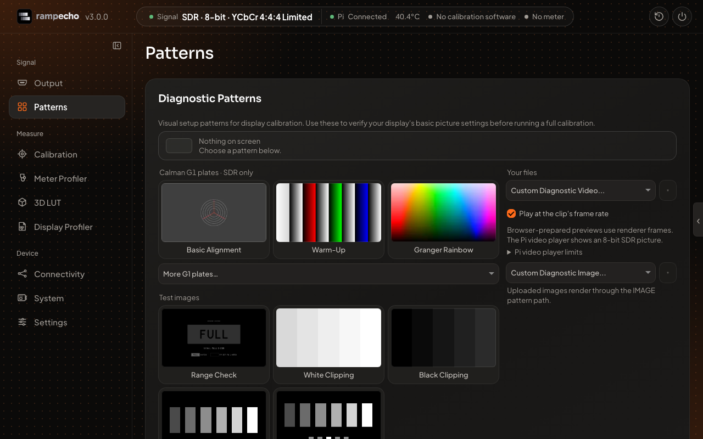
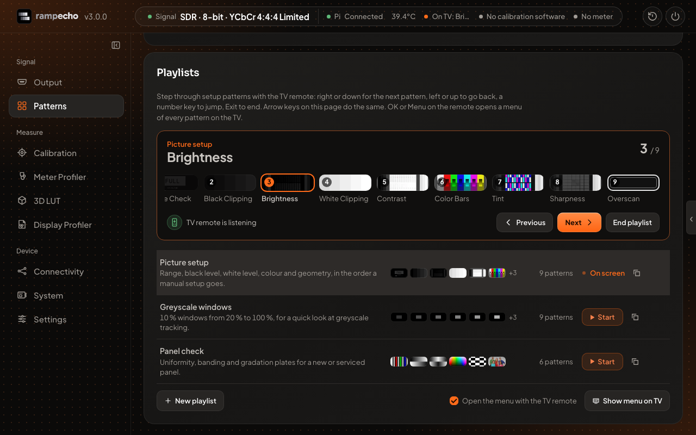
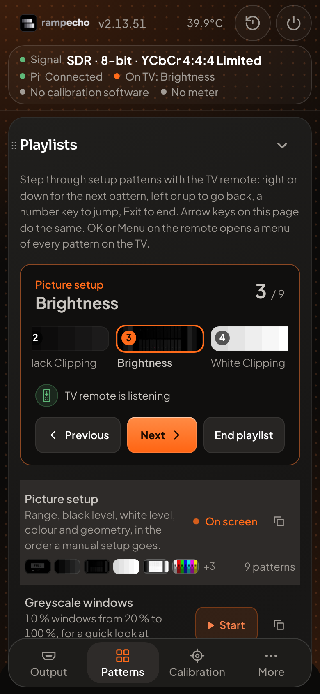
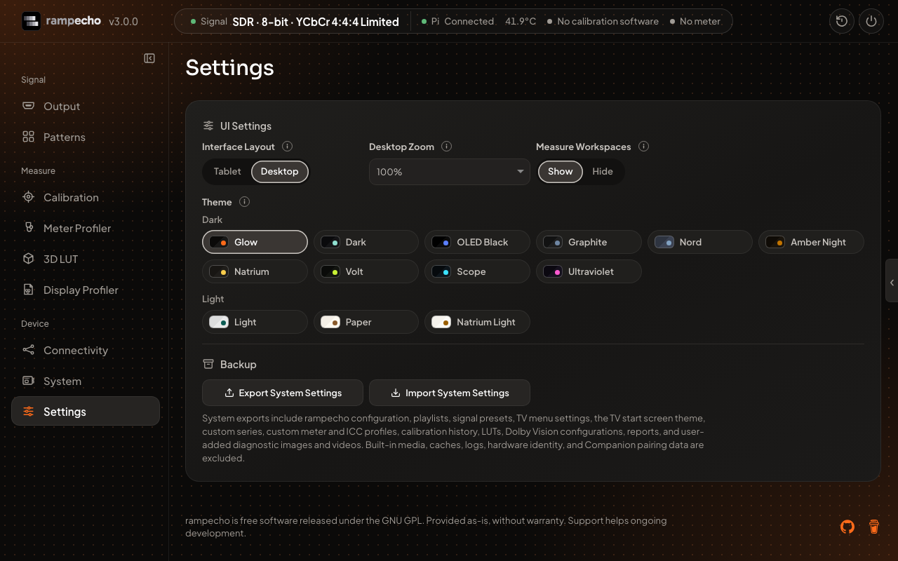
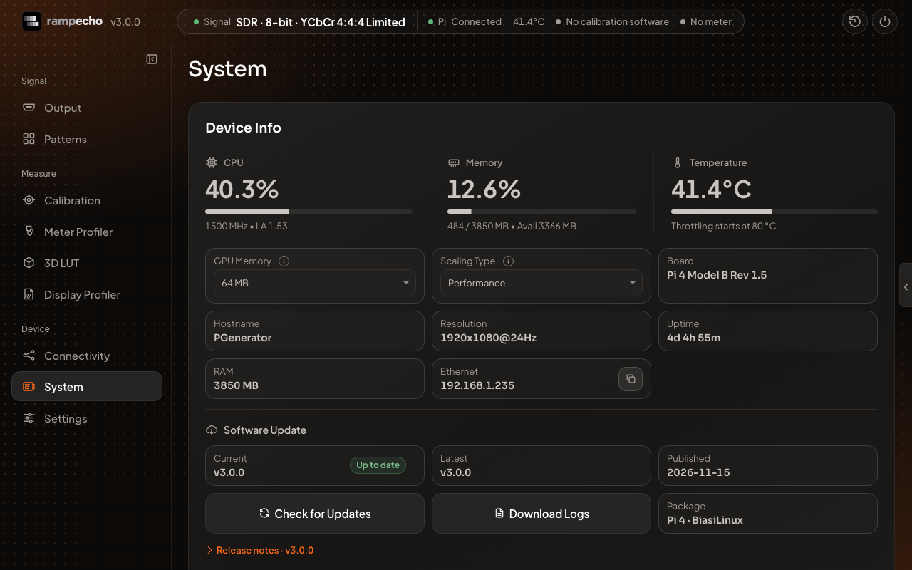
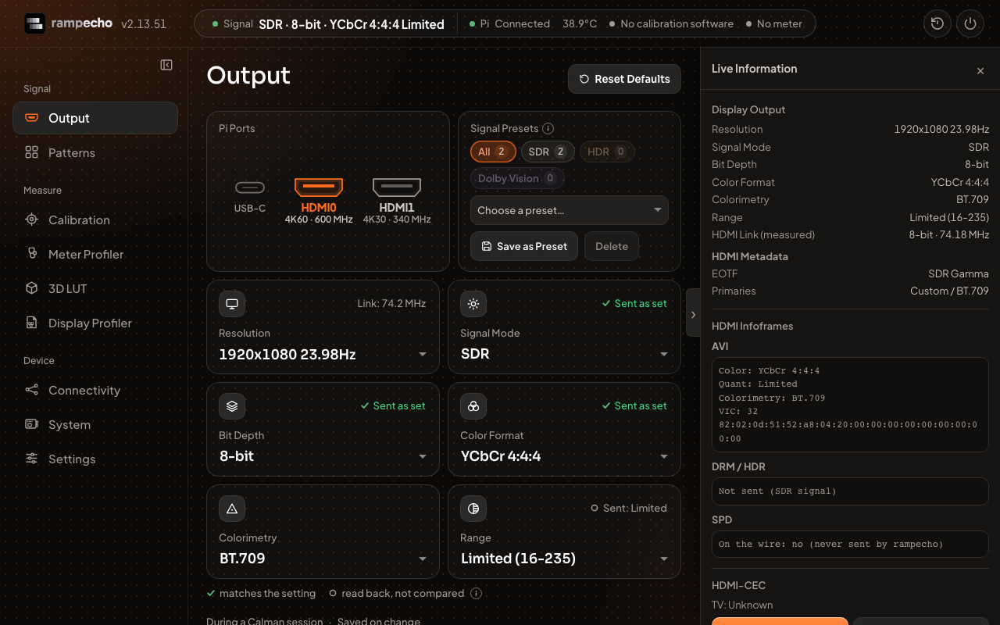
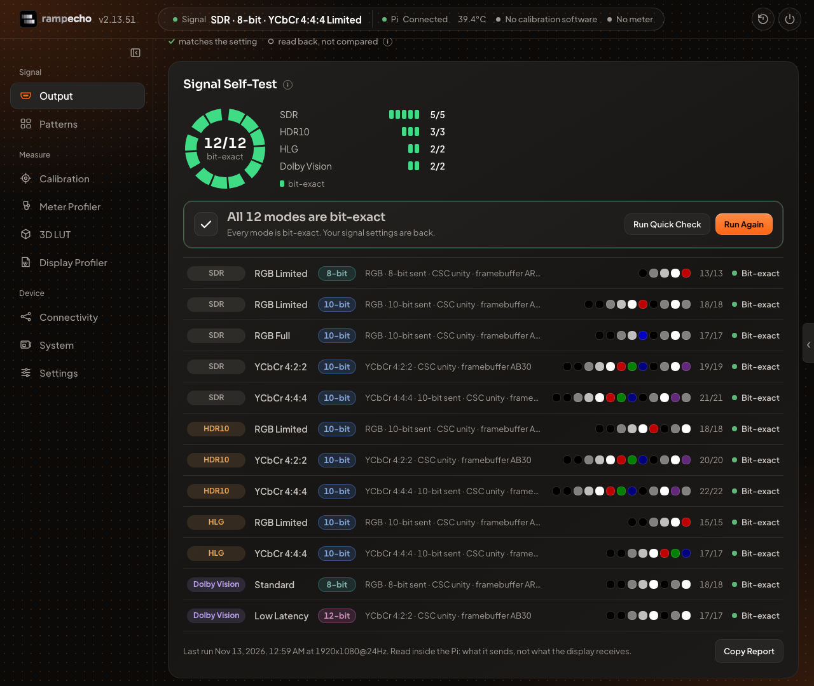
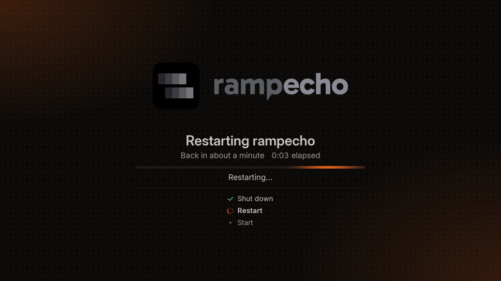

<p align="center">
  <picture>
    <source media="(prefers-color-scheme: light)" srcset="brand/rampecho-lockup-light.png"/>
    
  </picture>
</p>

<h3 align="center">The Raspberry Pi 4 pattern generator that proves its codes on the HDMI cable: bit-exact, Dolby Vision aware, driven from your TV remote</h3>

<p align="center">
  <a href="https://github.com/BlackJoker90/rampecho/releases/latest"></a>
  
  
  <a href="COPYING"></a>
</p>

<p align="center">
  <a href="#only-in-this-fork">Only here</a> ·
  <a href="#why-this-fork">Why this fork</a> ·
  <a href="#at-a-glance-fork-vs-original">Fork vs. original</a> ·
  <a href="#get-started">Get started</a> ·
  <a href="#calibration-software-compatibility">Calman &amp; co.</a> ·
  <a href="#reference">Reference</a> ·
  <a href="https://buymeacoffee.com/fabioelia9r">☕ Support</a>
</p>

<p align="center">
  
</p>

---

<a id="only-in-this-fork"></a>

## 🏆 Only in this fork

What no other PGenerator build does today. The comparison basis is the latest upstream PGenerator+ (2.12.1); none of these exist there.

<table>
<tr>
<td width="50%" valign="top">

### 🔬 Codes proven on the cable
The Pi reads back its own scanout. The built-in **Signal Self-Test** draws known codes in twelve signal modes and checks the pixels, the link depth, the AVI infoframe (format, range, colorimetry, VIC), the HDR metadata field by field and the Dolby Vision infoframe, in the form the display's Dolby block asks for. 10-bit codes stay 10-bit, and **RGB Limited goes out without the kernel's compression** (patched vc4). A full 0–1023 sweep comes back exact.

</td>
<td width="50%" valign="top">

### 🕶️ A silent source: no SPD InfoFrame
A stock Pi labels itself in the SPD InfoFrame (*"Broadcom Videocore"*), and displays can change the picture for the source type it names. [Light Illusion](https://www.lightillusion.com/hdmi_infoframes.html) saw it on an ASUS ProArt PA32DC: Low Latency Dolby Vision from a Pi was **limited to Rec.709**, and with the Pi's SPD removed it showed the **full gamut**, matching a Murideo SIX-G. The fork's vc4 driver **never sends the SPD InfoFrame**, and the WebUI shows the packet register as proof.

</td>
</tr>
<tr>
<td valign="top">

### 🌈 Dolby Vision that reads your display
The DV card decodes the display's **EDID Dolby block**: peak and black luminance, primaries, Standard and Low Latency support. Choosing DV fills in the display's own peak and black, flags mismatches and marks patches above the peak. **LLDV runs at 12-bit** and really switches the TV into DV.

</td>
<td valign="top">

### 📺 Patterns from the TV remote
Press **OK or Menu on the TV remote** and every pattern appears as a menu on the TV. **Playlists** step with the arrow keys over HDMI-CEC. No phone or laptop needed at the screen.

</td>
</tr>
<tr>
<td valign="top">

### 🎛️ Calman connects as a G1
Calman can drive rampecho as a **Portrait Displays G1**: patches, signal modes and all **19 G1 specialty patterns**, rendered on the Pi. The UPGCI connection works too, now with replies Calman can parse.

</td>
<td valign="top">

### ⚡ Fast, and it does not fall over
A signal mode change takes **~3.5–4.5 s instead of ~10 s**. Rapid setting changes are serialized, so they can no longer start two renderers and crash the HDMI driver. Without a display the renderer waits instead of failing.

</td>
</tr>
</table>

<a id="why-this-fork"></a>

## ✨ Why this fork

**rampecho** (formerly PGenerator+) is **BlackJoker90's fork** of [BigShoots/PGenerator-Plus](https://github.com/BigShoots/PGenerator-Plus). It branched from upstream 2.12.1 in September 2026 and has had **145+ commits and 30+ releases** since then (2.12.2 → 2.13.x). Upstream has nothing newer that the fork lacks.

Everything the original does is still here: patterns over TCP for Calman, ColourSpace, HCFR and Resolve; on-Pi meter workflows; LG AutoCal; profile building. The fork's focus is the **signal on the HDMI cable** and the **day-to-day experience**:

<table>
<tr>
<td width="50%" valign="top">

### 🎯 Bit-exact output
10-bit pattern codes reach the GPU **without 8-bit quantisation**. **RGB Limited is bit-exact**: a patched vc4 module skips the kernel's compression CSC. The set RGB range also reaches the cable when the Pi starts in the very mode the generator uses: the HDMI driver programs the range only on a mode switch, so the renderer switches the output off once before such a picture (one extra short blank at start). HDR10/HLG at 12-bit goes out as bit-exact 10-bit instead of crashing the renderer. **8-bit patterns on a 10-bit link** go out as exactly code × 4 (126 → 504), in SDR, HDR10 and LLDV. The G1 Brightness and Contrast plates switch to **10-bit steps** (0–95, 928–1023) on a 10-bit link. Scanout readback on the Pi checks the codes; nobody has to eyeball them. At 4K: 60 Hz in 8-bit RGB or YCbCr 4:2:2, 24 / 30 Hz up to 10-bit RGB ([which signals](#bit-exact-4k)).

</td>
<td width="50%" valign="top">

### ⚡ Faster signal switching
Changing signal mode takes **~3.5–4.5 s instead of ~10 s**. Format changes go into one atomic modeset, and signal settings are applied in place where possible. The link stays RGB until the renderer is up.

</td>
</tr>
<tr>
<td valign="top">

### 🎛️ Calman that just works
The UPGCI handshake now has proper ACKs and the settings format Calman actually parses. `GET_SETTINGS` works. Codes are rounded to the output depth, with a notice when a code is not exact. YCbCr 4:2:0 requests are refused cleanly with a NAK instead of breaking the link. Calman can also **connect to rampecho as a G1** and control it completely; the output follows what Calman shows (a G1 connection starts at RGB 8-bit Limited, like Calman's G1 source). All 19 **G1 specialty patterns** are rendered on the Pi; you start them from Calman or from the WebUI.

</td>
<td valign="top">

### 🌈 Dolby Vision, fixed
Low Latency DV renders at **12-bit** and really switches the TV into DV, with pattern codes sent at 10-bit. The display's EDID Dolby block sets the DV metadata defaults. Standard DV always uses the 8-bit tunnel the TV expects, on an **8-bit link** whatever bit depth is set: a 10-bit depth asked for by Calman or the API stays the setting for the signal after DV but is not put on the link (as PiTPG does), so it is no longer refused at 4K60. Patch codes keep their own depth inside the tunnel. Its AVI infoframe names the timing's own VIC instead of a fixed 1080p60 (CTA-861). Leaving DV signals "DV off" properly. A request that names only the new mode (the API) gets back the SDR colorimetry and, when DV was switched on in the WebUI or over the API, the format, range and depth from before it (a 12-bit depth comes back as 8-bit, and a format or depth the output does not carry at the mode it is in now is left out, which the reply says; after a Dolby Vision that Calman or a port 85 client switched on, the range alone); the page loads the new mode's recommended settings into the form, where you can change them before applying. Calman DV consistently runs as standard DV. Standard DV builds its metadata and tunnel codes the way PiTPG 2.0.3 does, with the metadata carried in one parity bit per pixel so the patch keeps its codes, and in two points the way ETSI GS CCM 001 asks where PiTPG does not: the L1 average is the value a display assumes without L1, (min + max) / 2 of the mastering PQ, and the packet's metadata id steps each time the metadata change; connected as PiTPG, ColourSpace also gets PiTPG's mastering display from Max/Min Luma, its BT.2020 or P3-D65 container and limited or full range. Standard DV's infoframe takes the form the display's EDID Dolby block asks for, as PiTPG 2.0.3 picks it: the HDMI 1.4b form for a version 0 block or a 15-byte version 1 block, the Dolby form for any other. Low Latency, always in the Dolby form, signals the BT.2020 container (PB5 0x10) to a display whose version 2 block declares Low-Latency-HDMI (interface bit 0). Both need the patched vc4; after an update the module loads with the next reboot.

</td>
</tr>
<tr>
<td valign="top">

### 🔌 Hotplug-safe
Without a display, the renderer waits instead of failing. The UI says so in a banner, and your saved mode is kept. After a hotplug the screen shows black instead of grey or a text console. Before a reboot or power-off, the HDMI link is handed back as plain RGB.

</td>
<td valign="top">

### 🖥️ A reworked Web UI
**14 themes** and workspace navigation. The default, **Glow**, lays Output out as a dashboard on warm near-black with one orange accent that is kept for the signal (the port in use, a value not applied yet, the action that sends it): the settings as tiles with an icon, each with a line for what the generator actually sends, the HDR metadata on its ST 2084 curve, and the Signal Self-Test as a ring with one segment per mode. The other themes (dark, light, OLED, Natrium, the lime Volt …) keep the look built for a dim room: large keys with their name inside, Dark and Light stepping in tone instead of drawing outlines, with a single aqua accent. The typefaces are served by the Pi itself, so the page looks the same without internet. Only sending patterns (for example from Calman or HCFR)? Hide the Measure workspaces with one switch in Settings. The UI shows the measured HDMI link depth and clock. It is served compressed with an ETag, pauses polling in hidden tabs and uses its own dialogs instead of browser pop-ups. Toasts appear only for warnings and errors.

</td>
</tr>
<tr>
<td valign="top">

### 📦 Safer OTA updates
Updates come from **this fork's releases**. The dialog shows the release notes and download progress. You can **reinstall or roll back** to an earlier release. Packages are about **20 % smaller** (stripped binaries, no duplicate files, unused Python modules dropped). Update checks are cached (gentle on the GitHub API), and cross-site requests to the WebUI are refused.

</td>
<td valign="top">

### 🧹 Small things that add up
mDNS answers AAAA queries with an NSEC record, so clients do not wait for an IPv6 address that never comes. `/api/lg/status` answers in milliseconds instead of ~4 s. Start and restart show an **animated progress screen on the TV** that follows the real boot steps in the colours of the WebUI theme you picked, and the WebUI follows a restart in its own dialog and reloads once the Pi is back. A renderer restart in YCbCr no longer flashes the screen green. **Faster start and reboot**: the WebUI answers about 25 s after the kernel starts, 10 s sooner than in earlier releases, and a reboot from the WebUI is back about 11 s sooner (USB network detection runs in the background, the WiFi driver is reloaded only when it failed, the WebUI starts before the renderer); every step is logged with its uptime in `/var/log/PGenerator/boot-times.log`. **Download Logs** replaces the old log upload.

</td>
</tr>
<tr>
<td valign="top">

### 🧪 Signal self-test
One button in **Output** runs twelve signal modes (SDR RGB Limited/Full and YCbCr 4:2:2/4:4:4, HDR10 RGB Limited and YCbCr 4:2:2/4:4:4, HLG RGB Limited and YCbCr 4:4:4, Dolby Vision Standard and Low Latency). In each mode it draws known codes (greys, colours checked against the BT.709/BT.2020 Y'CbCr formulas, 8-bit and 12-bit source codes), **reads back what the Pi scans out** and checks the link depth and the AVI infoframe: format, range, colorimetry and the VIC of the running mode. It also reads the infoframes from the HDMI packet RAM: HDR metadata only in HDR, field by field against your settings (ST 2084 primaries and luminances; HLG without mastering data), and in Dolby Vision the infoframe the display switches on (the Dolby VSIF with low latency for Low Latency; for Standard the HDMI 1.4b VSIF or the Dolby VSIF without low latency). Your signal settings come back afterwards; a quick check covers three modes in about 40 s.

</td>
<td valign="top">

### 📺 Pattern menu and playlists on the TV remote
Press **OK or Menu on the TV remote** and a menu of every pattern appears on the TV: G1 plates, test images and playlists as thumbnails. Arrows move, OK shows the pattern, left/right step on, Back returns to the menu. No phone needed. It dims itself in HDR and Dolby Vision and closes after ten idle minutes (OLED). Playlists step the same way: right or down for next, left or up for back, a number key to jump, Exit to end. Three built-in playlists (Picture setup, Greyscale windows, Panel check), plus your own from G1 plates, test images, uploads and APL windows. A deck on the page shows where you are.

</td>
</tr>
<tr>
<td valign="top">

### 🚫 Refused settings, with the reason
A setting the Pi or the display cannot carry is **refused instead of quietly changed**: 10-bit RGB at 4K 60 Hz needs 742.5 MHz on the link and the Pi 4 sends at most 600 MHz; a YCbCr format, a bit depth or an HDR mode missing from the display's EDID; TV-led Dolby Vision at 4K 60 Hz or low-latency DV in RGB where the display's Dolby block does not list it. The output stays as it was, the WebUI says why and what works instead, and **patches are refused until working settings arrive** (Calman gets a NAK). In Output, options that cannot go out stay visible but locked, with the reason next to them.

While **Calman, ColourSpace or LightSpace is connected, it sets the signal**: the Output settings, presets and Apply are locked with the reason, and `/api/config` refuses signal changes, so the cable keeps what the software shows. Settings other than the signal still save; HCFR and Resolve only send patches and leave the signal to the WebUI. **Range with Calman** (below the Display Settings) is the exception for the range: *Always Full* or *Always Limited* holds for the whole Calman session, whatever range Calman asks for (also its Default), and can be changed while Calman is connected (it applies from Calman's next pattern; back to *Follow Calman*, the default, from Calman's next range command). When Calman's socket closes without a SHUTDOWN, *Always Full* or *Always Limited* gives the WebUI's range back as after one. YCbCr is Limited on the cable either way: *Always Full* then reads Calman's patterns as 0-255 codes. Dolby Vision keeps the range of its transport. Sessions are tracked per socket and port: Calman from its `INIT` on 2100 (UPGCI) or 2101 (G1), not from its discovery probe; port 85 clients from their first pattern. A session ends with Calman's `SHUTDOWN` or when its socket closes, and a client that vanishes without closing (VM paused, network gone) is dropped after about a minute by TCP keepalive instead of staying "connected". The header tooltip lists each session with port, protocol and when data last came.

</td>
<td valign="top">

### 🔗 What is on the cable, and when the link dropped
Signal Mode, Bit Depth, Color Format and Range each have a **Sent** line: what the Pi actually sends, read inside the Pi from the infoframes and the encoder (Resolution shows the link clock; Colorimetry is read, see Live Information, but not compared). A check means it matches the setting, a warning names what is sent instead, and below the fields every quiet adjustment is spelled out ("12-bit setting is sent as 10-bit."). In Dolby Vision the Signal Mode field compares the whole vendor infoframe with the one the display's Dolby Vision block asks for, by the Signal Self-Test's rule, and names the form when another one goes out. A field that is not compared (the 12-bit container of 4:2:2, the range of YCbCr, a new output before its first picture) or was compared against other settings (Calman changed them) shows the value without a verdict. It proves what the Pi sends, not what the display receives. Hover over the signal or the calibration program in the header for the same. If the HDMI link drops while Calman is connected or a measurement runs (display reset, input change, power off), the time is recorded and a notice says the readings across it can't be combined.

</td>
</tr>
</table>

<a id="at-a-glance-fork-vs-original"></a>

## ⚖️ At a glance: fork vs. original

| | Original ([BigShoots](https://github.com/BigShoots/PGenerator-Plus) 2.12.1) | **This fork (2.13.x)** |
|---|---|---|
| 10-bit pattern codes | quantised through 8 bit on the way to the GPU | **sent at full 10-bit precision** |
| RGB Limited output | kernel compression CSC after the framebuffer | **bit-exact** (patched vc4, verified by scanout readback) |
| HDR10 / HLG at 12-bit | renderer crashed | bit-exact 10-bit |
| HLG meter targets | power curve: 50 % HLG targeted 435 cd/m² on a 1000 cd/m² display | **ITU-R BT.2100 HLG** (50 % → 51 cd/m², 75 % → 203 cd/m²); colour and saturation targets are the BT.2100 display of the codes sent |
| Signal-mode switch | ~10 s | **~3.5–4.5 s** |
| Low Latency Dolby Vision | TV did not switch into DV | 12-bit, TV switches into DV; for ColourSpace connected as PiTPG also RGB at the 10/12-bit depth the display's Dolby block lists |
| Standard Dolby Vision metadata | fixed Dolby default mastering display, limited range only | **as PiTPG 2.0.3**, with ETSI GS CCM 001's L1 average and a metadata id that steps on each change: metadata in a parity bit; for a PiTPG client the mastering display from Max/Min Luma, BT.2020 or P3-D65 container, limited or full range |
| Standard Dolby Vision AVI infoframe | VIC always 16 (1080p60), also at 24, 30 Hz or 4K | **the VIC of the timing on the cable** (e.g. 1080p24 → 32, 2160p24 → 93; patched vc4) |
| Dolby Vision vendor infoframe | Standard always in the HDMI 1.4b form, Low Latency always with PB5 0 | **the form the display's Dolby block asks for, as PiTPG 2.0.3**: Standard in the HDMI 1.4b or Dolby form, Low Latency PB5 0x10 (BT.2020 container) when a version 2 block declares Low-Latency-HDMI (patched vc4) |
| Calman UPGCI | settings replies Calman could not parse | ACK + parseable settings, `GET_SETTINGS` |
| Calman YCbCr 4:2:0 request | no defined answer | clean NAK, current format kept, WebUI notice |
| Settings the Pi or display can't carry | applied anyway: vc4 quietly lowers the depth, or the display shows nothing | **refused with the reason** (link bandwidth, EDID), output kept, patches refused until working settings arrive |
| WebUI signal change during a Calman / ColourSpace session | applied, so the cable no longer matched what the software showed | **locked with the reason**: the software sets the signal while it is connected |
| Range with Calman | – | **Follow Calman**, or **Always Full** / **Always Limited** for the whole Calman session |
| Calman's Dolby Vision patches | signalled in the BT.2020 container | **signalled in the P3-D65 container, as PGenerator 1.6 did**: Calman's patches are colours of its P3 target; BT.2020 selectable (**Dolby Vision with Calman**) |
| Calman's percent greys on an 8-bit output | 10-bit code with the low bits dropped | **the 8-bit code of that percent, as Calman's own 8-bit formula gives it**; other 10-bit codes go to the nearest code with a notice |
| What goes out on the cable | – | **shown in each setting field**, checked against the setting, quiet adjustments named (e.g. 12-bit sent as 10-bit); in Dolby Vision the vendor infoframe against the display's Dolby block |
| Range mismatch between Pi and display | – | **Range Check** test image: shows whether the display decodes Limited or Full, next to the range on the cable, plus an EDID check that predicts from the display's EDID (QS/QY) and the Pi's AVI infoframe (Q/YQ, VIC) whether the display on Auto matches |
| Where an HDR10 display clips, and whether it follows the metadata | – | **HDR Steps**: grey bars at absolute luminances up to the applied Max Luma (MaxDML), each at its exact PQ code (ST 2084, quantised as BT.2100) for the depth and range on the cable, the luminance and the code named under every bar, drawn again when signal settings are applied. **HDR Metadata Cycle**: the same bars up to 10,000 cd/m², unchanged, while MaxDML and MaxCLL step through 600, 1000, 2000, 4000 and 10,000 every 6 s (MaxFALL never above the step's MaxCLL); your own values come back when it ends: another pattern, applied settings, calibration software connecting, or by itself after 30 minutes |
| HDMI link drop during a measurement | – | **recorded with the time**, notice and banner: readings across it can't be combined |
| Calman connection as G1 | – | **full control** from Calman (patches, signal modes, G1 patterns) |
| Calman G1 specialty patterns | – | all 19 rendered on the Pi, started from Calman or the WebUI |
| No display connected | renderer started anyway | waits for a display, banner in the UI, saved mode kept |
| Rapid setting changes | could start two renderers at once (vc4 crash, reboot needed) | **serialized**: one renderer, no crash |
| Display's Dolby Vision block | only "DV supported" | peak, black, interfaces and primaries shown; mismatch warnings; patches above the peak flagged |
| SPD InfoFrame | always sent ("Broadcom Videocore", media player); can limit a display's LLDV gamut to Rec.709 (ASUS PA32DC, Light Illusion) | **never sent**: removed in the vc4 driver (Pi 4) |
| Diagnostic video player | – | **8-bit SDR picture**, H.264 via V4L2 hardware decode and zero-copy DRM scanout when available; software fallback and other codecs (limits below). **Play at the clip's frame rate** switches the output to the configured resolution at the clip's rate (23.976 to 60 Hz) while it plays |
| WebUI themes | dark / light / system | **14 themes**: Glow (the default, with a dashboard layout for Output), Natrium dark & light, Volt, Scope, Ultraviolet … |
| WebUI look | – | signal settings as keys with their name inside, each with its read-back line, own typeface served by the Pi (works offline); a select's menu opens above or below its key, never over its name |
| Measurement workspaces | – | **can be hidden** in Settings for pattern-only setups (Calman, HCFR) |
| HDMI link readout | – | measured link depth and clock |
| CPU scaling governor | fixed in `/etc/default/rcPGenerator` | **Scaling Type in the WebUI**, applies without a reboot |
| OTA | latest release only | release notes, progress, **reinstall / rollback**, ~20 % smaller packages |
| Self-test of the HDMI output | – | **built in**: scanout readback, link depth, AVI (colorimetry, VIC), HDR metadata fields and Dolby Vision infoframes per mode (form checked against the display's Dolby block), HLG included |
| Pattern playlists | – | **stepped with the TV remote** (HDMI-CEC), own playlists |
| On-screen pattern menu | – | **every pattern on the TV**, picked with the remote |
| Start and restart | static splash, WebUI just goes offline | **animated progress on the TV** (real boot steps, in the WebUI theme), restart dialog in the WebUI that reconnects by itself; WebUI up about 25 s after the kernel starts |
| Popups | success and error toasts | warnings and errors only |
| Test EDID | – | **file on the boot partition** replaces the display's EDID (kernel `edid_override`), banner while in use |
| ColourSpace's `PiTPG` hardware entry | – | **PiTPG protocol 2 on port 85**: patches with frame timing, signal settings, the 11 PiTPG test patterns, EDID / HDMI / InfoFrame texts |

> The left column describes upstream behaviour as stated in the fork commits that changed it. Run `git log origin/main..main` in a clone with both remotes for the full list.

## 📸 Screenshots

<table>
<tr>
<td width="68%" valign="top"></td>
<td width="32%" rowspan="3" valign="top"></td>
</tr>
<tr>
<td align="center"><sub>Playlists: the deck follows the TV remote; Start, duplicate or edit from the library</sub></td>
</tr>
<tr>
<td valign="top"><br/><p align="center"><sub>Settings: themes, layout and backup in one place</sub></p></td>
</tr>
<tr>
<td colspan="2" valign="top"><br/><p align="center"><sub>System: CPU, memory and temperature at a glance, the device facts, GPU memory and CPU Scaling Type set right in their tiles, and the OTA update</sub></p></td>
</tr>
<tr>
<td colspan="2" valign="top"><br/><p align="center"><sub>Output on Desktop with the two Calman options, and Live Information: the output as measured, the infoframes the Pi sends, decoded and updated as the signal changes, and HDMI-CEC with the TV remote</sub></p></td>
</tr>
<tr>
<td colspan="2" valign="top"><br/><p align="center"><sub>Signal self-test, right below Display Settings: every mode read back from the scanout on a real Pi 4, bit-exact in 12 of 12</sub></p></td>
</tr>
<tr>
<td colspan="2" valign="top"><br/><p align="center"><sub>On the TV during a restart, in the Volt theme (rendered by the Pi's start screen program); at start-up the same screen follows System, Network, Services and PGenerator+</sub></p></td>
</tr>
</table>
<p align="center"><sub>Top right: the same playlists on a phone, with a bottom tab bar</sub></p>

---

<a id="get-started"></a>

## 🚀 Get started

### 💾 New install: flash the image

1. Download the newest release that has image parts, from [Releases](https://github.com/BlackJoker90/rampecho/releases) (`PGenerator_Plus_vX.Y.Z_pi4.img.xz.001` and `.002`).
   Image releases are rare by design. Most releases are OTA-only, so grab the latest image and update from there.
2. Join the parts and flash:
   - **Windows:** open `.001` with [7-Zip](https://www.7-zip.org/) to get the `.img`, then flash it with [Balena Etcher](https://etcher.balena.io/) or [Rufus](https://rufus.ie/).
   - **macOS / Linux:** `cat PGenerator_Plus_*_pi4.img.xz.0* > pgen.img.xz`, then flash `pgen.img.xz` with [Raspberry Pi Imager](https://www.raspberrypi.com/software/). Imager reads `.xz` directly.
   - Use a microSD card or USB stick of at least 8 GB.
3. Boot the Pi and connect to it, using one of the methods below.
4. Open **`http://pgenerator.local`** (or the Pi's IP address).
5. Go to **System → Software Update → Check for Updates** to move to the newest OTA release.

<details>
<summary><b>Connection methods (Bluetooth PAN, Wi-Fi AP, Ethernet)</b></summary>

- **Bluetooth PAN:** pair with the Pi, then join its PAN in Windows settings.
  <p align="left">
    
    
    
    
    
  </p>
- **Wired PAN:** Ethernet cable directly between your computer and the Pi.
- **Wired LAN:** Pi on your router or switch.
- **USB:** the Pi 4's USB-C port to your computer: a network as CDC-NCM (Linux, macOS, Windows 11 without a driver), rebuilt as RNDIS when the computer does not use NCM within 5 s (older Windows). The Pi is `10.10.12.1`; the boot partition also appears as a drive.
- **Wireless PAN:** join the Pi's access point (SSID `PGenerator`, password `PGenerator`).
  <p align="left"></p>
- **Wireless LAN:** join your own Wi-Fi from **Connectivity** in the Web UI, after connecting once by one of the methods above. Joining and getting an address can take up to a minute; the Web UI waits for it.
- **Wireless LAN over SSH** (`root` / `PGenerator!!$`): add the network to `/etc/wpa_supplicant/wpa_supplicant.conf` and restart the WiFi client; the Pi joins it on every boot from then on.

  ```bash
  wpa_passphrase "YourNetwork" "YourPassword" | grep -v '#psk' >> /etc/wpa_supplicant/wpa_supplicant.conf
  /etc/init.d/wpa_supplicant restart
  ```

</details>

### 🔀 Coming from the original project?

OTA updates stay within one `MAJOR.MINOR` family. 2.13 needs a new kernel module, so a Pi on upstream 2.12.x cannot update to the fork over the air. To switch:

1. Export your settings with **Export System Settings** in the Web UI.
2. Flash the latest fork image (see above).
3. Import the backup, then use **Check for Updates** to reach the newest 2.13.x.

From then on the Pi follows this fork's releases. The update source is `usr/share/PGenerator/update-channel`, and an `update_repo=owner/repo` line in `PGenerator.conf` overrides it.

### ⬆️ Updating

- **Web UI:** **System → Software Update → Check for Updates → Install Update.** The dialog shows the release notes and download progress, then restarts the service. The release dropdown also lets you reinstall the current release or roll back to an earlier one.
- **SSH** (`root` / `PGenerator!!$`):

  ```bash
  /usr/sbin/pgenerator-update check   # is there something newer?
  /usr/sbin/pgenerator-update apply   # install it
  ```

---

## 🎨 What rampecho does

rampecho is a free, open-source display calibration suite for the Raspberry Pi 4, built around a precision HDMI test pattern generator. It produces SDR, HDR10, HLG and Dolby Vision patterns. The calibration software on your laptop drives it over TCP/IP, or it runs closed-loop SDR and HDR workflows on the Pi itself with a USB colorimeter.

- **Precision HDMI patterns:** full-screen patches, windows, APL backgrounds, custom RGB triplets and patch sizes, drawn through DRM/KMS.
- **HDR and Dolby Vision:** HDR10 (ST.2084 PQ with mastering metadata), HLG, standard and Low Latency Dolby Vision. AVI, DRM and DOVI infoframes are set correctly, and capabilities are detected from the EDID.
- **Network control:** Calman (UPGCI, port 2100), ColourSpace / LightSpace and HCFR (port 85; ColourSpace also through its `PiTPG` entry, PiTPG protocol 2), DeviceControl, and the Resolve XML protocol (port 20002, outbound). UDP discovery runs on port 1977. Names and values a port 85 client sends never reach a shell or a path outside their directory, and templates never run as Perl (`EVALPATTERN` templates are refused, as `EVAL=` lines always were): template names (`GETCONF`, `SETCONF`, `TESTTEMPLATE`, `SAVEIMAGES`) are file names without `/` or control characters, `FUNCTIONS` names are plain words, and `VIDEO` plays only with `omxplayer` or `pg_diag_video_player`, a file under the video directory and a duration such as `30s`. A refused request is answered `ERR` (`ERR:Refused: …` where the command has a reply).
- **Web dashboard:** signal settings, diagnostic patterns, a live infoframe decoder, HDMI-CEC, networking, OTA, and meter measurements. The measurement workspaces can be hidden for pattern-only setups.
- **LG AutoCal (SDR and HDR):** on-device closed-loop calibration of LG TVs: 26-point greyscale, RGB balance, 3D LUT and HDR tone mapping, with an optional Tone Mapping Shadow Fix.
- **Meter workflows:** ArgyllCMS `spotread` with persistent sessions, greyscale, colour and saturation sweeps, CCSS management, and live ΔE and chromaticity charts.
- **Display profiles:** measured Windows MHC2 and KDE HDR cLUT profiles (ICC v2.2 / v4.4 with CICP), built in the browser.
- **mDNS:** reachable at `pgenerator.local`.
- **Field networking:** Bluetooth PAN, Wi-Fi AP, Ethernet.

---

<a id="calibration-software-compatibility"></a>

## 🤝 Calibration software compatibility

**1. Calman (Portrait Displays)**

- **Protocol:** SpectraCal Unified Pattern Generator Control Interface (port `2100`)
- **Connect:** **Find Source** → Manufacturer `SpectraCal` (or `Portrait Displays`) → Model `SpectraCal - Unified Pattern Generator Control Interface`. Enter the Pi's IP and connect.
  - *Calman control:* rampecho applies Calman's commands for SDR / HDR10 / HLG, EOTF, colorimetry, format and mastering metadata in real time. In Calman 2026 the UPGCI source itself only has an HDR switch with EOTF and mastering metadata; colour format, bit depth, range, resolution and Dolby Vision are settings of the **Portrait Displays G1** source (*Connect as G1* below), or stay as set in Output. In HDR10, HLG and Dolby Vision the colorimetry stays BT.2020, the container these signals are defined in; a BT.709 gamut target is drawn inside it.
  - *Dolby Vision needs the G1 source:* the UPGCI source does not send Calman's Dolby Vision command (`CONF_DV`). In a Calman 5.14 log, "Dolby Vision RGB Tunneling" sent the same commands as HDR10, so the output is HDR10. Connect as **Portrait Displays G1** instead, which sends it. Whether Calman Home offers the G1 source is not confirmed. Connecting the UPGCI source while Dolby Vision is on switches the output to SDR (its handshake sends `HDR_ENABLE:False`), in the range Output had before Dolby Vision, when that was switched on in the WebUI or over the API with 2.13.48 or later.
  - *Bit depth:* the Calman thread follows the configured bit depth. 10-bit codes stay exact. Calman sends a grey it holds as a percent level in 10 bit whatever its bit depth setting says (20 % Limited is 239), and RGB triplets as 8-bit codes times 4. On an 8-bit output a whole-percent grey gets the 8-bit code of that percent (Calman's own 8-bit formula: 2 % Limited is 20, where rounding the 10-bit code 82 gives 21); any other code 8 bit cannot carry goes to the nearest code, with a notice for the patch. The `RGB_S`, `RGB_B` and `RGB_A` patches and their backgrounds are converted this way (a rounded background has no notice of its own); a `CommandRGB` flagged as 10 bit keeps the nearest code. In Full range a percent grey whose 10-bit code is a multiple of 4 cannot be told from a triplet and keeps code/4, which can be one code off.
  - *Dolby Vision container:* in a Calman session, Standard Dolby Vision signals the **P3-D65** container (BT.709 YCC matrix and P3 `rgb_to_lms` in the metadata), as PGenerator 1.6 did: Calman's Dolby Vision patches are RGB of its P3 target (red is 504,64,64). **Dolby Vision with Calman** in Output switches to BT.2020, the container versions up to 2.13.45 signalled; there the same patches are BT.2020 colours and measure more saturated than Calman's targets, while greys are the same. The container applies from the first picture Calman shows (or from Calman switching Dolby Vision on itself) until Calman disconnects, to everything shown in Standard Dolby Vision in that time, the WebUI's own patterns and measurements included; a Calman that connects and shows nothing changes nothing. When the last Calman session ends, Dolby Vision that stays on goes back to BT.2020, which the WebUI's own patterns and measurements are computed for: the renderer restarts once for it and the last patch is no longer shown. Low Latency Dolby Vision has no container of its own and is not touched.
  - *Modes:* `CONF_FORMAT` requests resolve to the EDID copy of a mode rather than the userdef boot mode. G1 sessions start at Calman's RGB 8-bit default.
  - *Range:* the output follows Calman's range commands. A G1 session starts at the range on the cable (the Range setting in Output), which the Pi reports to Calman; without that report Calman's G1 source forces Limited at every connect. **Range with Calman** in Output keeps the range Full or Limited for the whole session whatever Calman asks for; set Calman's patterns to the same range then. The UPGCI source has no range setting; in Calman 2026 its patches arrived as video levels (20 % grey is 240 of 1023) whatever range the Pi reported, so they fit a Limited output. On YCbCr the cable stays Limited and *Always Full* means Calman's patterns are read as 0-255.
  - *Windows and APL:* fixed, custom and gray-surround APL windows (`RGB_S`, `RGB_A`, `CommandRGB`, `10_SIZE`, `11_APL`). With limited range, window backgrounds are drawn at black.
  - *Unsupported formats:* a YCbCr 4:2:0 request gets a NAK, and the WebUI shows a notice. The current format stays.
  - *Refused settings:* settings the Pi or the display cannot carry (link bandwidth, missing EDID support for a format, depth or HDR mode) get a NAK. The output stays as it was, the WebUI shows the reason and what works, and patches get a NAK until Calman sends settings that work (or disconnects). The same applies to port 85 clients (`ERR:Refused: …`).
  - *YCbCr is always Limited:* with Range Full on a YCbCr output (Calman, LightSpace), the full-range codes are converted to studio range (0–1023 → 64–940) and the AVI infoframe says Limited, also on modes without a CEA VIC.
  - *Session safety:* pattern state is cleared on session start, shutdown and disconnect.
  - *Connect as G1:* Calman can also connect through **Find Source → Portrait Displays G1** and controls rampecho completely that way: patches, signal modes and every G1 specialty pattern (Basic Alignment, Warm-Up, Granger Rainbow, Brightness, Contrast, Color Bars, SMPTE, ANSI checkerboards and the rest). The same 19 patterns are in the WebUI under Patterns.
  - *Compatibility note:* rampecho is an independent community project, not affiliated with or endorsed by Portrait Displays. Make sure your Calman license and workflow comply with the vendor's terms.
  - *License note:* Portrait Displays removed UPGCI from Calman **Home** licenses starting with 5.15.x (2024). Home users need 5.14.x or older, a professional tier, or other software (ColourSpace, HCFR).

**2. ColourSpace / LightSpace CMS**

- **Protocol:** XML network calibration protocol (port `85`)
- **Connect:** **Hardware Options** → Hardware `Network` (or `PGenerator`) → enter the Pi's IP.
- **Connect as PiTPG:** in a Profiling window, **Hardware Options** → Hardware `PiTPG` → enter the Pi's IP in *Network Address* (rampecho is `pgenerator.local`, not `PiTPG.local`). Port 85 tells the two protocols apart by the client's first bytes, so the classic entry keeps working.
  - *What it does:* PiTPG protocol 2 as PiTPG 2.0.0 answers it (reported edition `basic`): settings with PiTPG's value ranges, rolled back when one is refused, and after a refusal patches are refused until settings that work come or ColourSpace disconnects (HDR metadata sent in between waits until then); modes matched to the display's own list within 0.005 Hz, the EDID's timing preferred over the userdef boot mode; patches whose reply carries the DRM flip that showed them (sequence, time, frame period); the 11 test patterns (Contrast, Brightness, ANSI 1/2, Corner Box 1/2, Probe Alignment, Granger, horizontal and vertical ramps, FALD) drawn in the last patch's window; a peak note for HDR10 and Dolby Vision patches above the display's declared peak; HDMI info, EDID, InfoFrames, log and kernel log as texts.
  - *Codes and depth:* as in PiTPG, patch codes go out unchanged: the patch scale (Full, Legal, Extended) sets the RGB range in the AVI infoframe, not the codes (in TV-led Dolby Vision it sets the range of the Dolby signal instead: Full gives full-range tunnel codes and metadata, Legal and User limited ones, Extended is refused), and the link follows the patch depth (8-bit patches on an 8-bit link, 10-bit patches need a 10-bit one; TV-led Dolby Vision stays on its 8-bit tunnel link with either). Both end with the next settings change and when ColourSpace disconnects, and the output settings in effect before them come back.
  - *Differences from a PiTPG:* Granger is not drawn in Dolby Vision, YCbCr with a Full scale is refused (YCbCr is always Limited), and refused settings are put back rather than kept, and their refusal ends when ColourSpace disconnects. Ted's Edition content is not part of it.

**3. HCFR**

- **Protocol:** network pattern generator commands (port `85`)
- **Connect:** **Measures → Generator → Configure** → `Network`, then enter the Pi's IP.
- Generator behaviour has been cross-checked against the upstream [HCFR](https://github.com/hcfr/hcfr) source. HCFR itself is not bundled.

**4. Resolve protocol (Calman / HCFR / DisplayCAL)**

- **Protocol:** XML calibration protocol (port `20002`). rampecho connects *outbound* to the calibration PC, which helps across subnets.
- **Connect:** in the Web UI's **Resolve Protocol** card, enter the PC's IP and port and click **Connect**.
- **Range:** the protocol carries no range. The codes are drawn as sent, in the range set in Output; Resolve neither changes the range nor gives one back when it disconnects. Set the client's levels to the display's input range: on RGB Limited (and on YCbCr) the client sends video levels (DisplayCAL: Output levels *Auto* detects it, or *TV RGB 16-235*; ColourSpace: Patch Scale *Legal*), on RGB Full it sends full range.
- **Bit depth:** the XML's `bits` is the precision of the patch codes, not an output setting. The output keeps the depth set in the WebUI: 8-bit codes on a 10-bit output take the same 8 → 10-bit step as the G1 patches, 10-bit codes on an 8-bit output are scaled to 8 bits by the renderer.
- **Windows redirect helper:** `tools/PGenerator-Resolve-Redirect.bat` forwards Calman's local port 20002 to the Pi.

**5. DeviceControl**

- UDP discovery on port `1977` (`"Who is a PGenerator"` → `"I am a PGenerator <name>"`) plus TCP pattern control. With the stock hostname, the device advertises itself as `PGenerator+`.

---

## 🗺️ Web UI tour

Served on **port 80** at `http://pgenerator.local`. It has a **Desktop** layout with a sidebar of workspaces and a **Tablet** layout for tablets and phones: a bottom tab bar opens one workspace at a time (Output first), with draggable, collapsible cards. The layout is chosen in Settings → UI Settings.

| Workspace | What's in it |
|---|---|
| **Output** | Signal mode (SDR / HDR10 / HLG / Dolby Vision), resolution from the EDID, bit depth, colour format, colorimetry, range, and HDR10 and DV metadata (with hints for measuring Dolby Vision); **Range with Calman** (follow Calman, or always Full / Limited) and **Dolby Vision with Calman** (P3-D65 or BT.2020 container for Calman's Dolby Vision patches). Options the Pi or the display cannot carry stay visible but locked, with the reason. A **Sent** line in each setting field shows what is actually sent, checked against the setting, and any quiet adjustment; banners show refused settings (with what works), HDMI link interruptions during a measurement and a test EDID in use. Shows a banner while no display is connected. Moving the cable to the other HDMI port keeps the resolution (the mode is followed by its timing, not its list position) and the output follows the cable. Below it the **Signal Self-Test**: draws known codes in every signal mode and reads the scanout back, next to link depth, range CSC, AVI infoframe, HDR metadata and the Dolby Vision infoframe |
| **Patterns** | Calman G1 plates (favourites Basic Alignment, Warm-Up, Granger Rainbow, plus all others; Basic Alignment doubles as an overscan check: numbered rings 1 to 5 % in from each edge, so the outermost ring still visible shows how much the display crops), the test images Range Check (sub-black codes show whether the display decodes the signal as Limited or Full, next to the range on the cable; an EDID check from the display's EDID and the Pi's AVI infoframe says whether the display on Auto should match), White Clipping and Black Clipping, in HDR10 **HDR Steps** (PQ bars up to the applied Max Luma: the last bar you can tell from its neighbour is where the display clips) and the **HDR Metadata Cycle** (the mastering peak and MaxCLL on the cable change every 6 s under an unchanged picture: a display that follows the metadata changes its tone mapping with each step; it ends by itself after 30 minutes), your own uploaded images and videos (browser-prepared renderer previews or the 8-bit SDR Pi video player; see limits below), and **playlists** you step through with the TV remote; "Show menu on TV" opens the on-screen pattern menu |
| **Calibration** | Meter detection, single and continuous reads, series runs (Greyscale 21/11, Colors 30, Saturation 24), charts, and session export |
| **Meter Profiler** | Meter correction (CCSS) editor and preview |
| **3D LUT · Display Profiler** | LUT handling, MHC2 / KDE HDR profile building |
| **Connectivity** | Wi-Fi client, access point and Bluetooth in one Network card, LG TV control (pairing, AutoCal: greyscale, 3D LUT, HDR tone map, Shadow Fix) and the Resolve client; on Tablet and Phone also HDMI-CEC |
| **System** | Device info: CPU, memory and temperature with meters, plus board, hostname, resolution, uptime, RAM and the network interfaces; GPU memory (asks before the required reboot) and CPU **Scaling Type** (Performance recommended, applies at once) are set in their tiles. Below the device info: Software Update (with notes, progress, rollback) and Download Logs |
| **Live Information** (right-hand drawer on Desktop) | Active signal, the infoframe decoder (AVI, DRM and SPD), the measured HDMI link depth and clock, and HDMI-CEC with the TV remote. Updated while open; a failed read says how old the frames on screen are. On Tablet and Phone the infoframe decoder is a card in **System** |
| **Settings** | Layout, zoom, **14 themes** (Glow is the default), Show/Hide for the Measure workspaces, and settings backup and restore |

**Custom Diagnostic Video — Pi player limits.** `pg_diag_video_player` uses the Pi 4's bcm2835 H.264 hardware decoder when `/dev/video10` identifies it and `pg_v4l2_player` is installed. ffmpeg only demuxes H.264 and inserts access-unit delimiters; decoded 8-bit YU12/NV12 DMA-BUFs go directly to a DRM overlay. The HVS scales the visible crop, preserves the display aspect ratio for unrotated input and converts YCbCr to RGB, with black borders. Clips with rotation tags or display-matrix side data use software ffmpeg autorotate before aspect fitting. On the hardware path, no decoded pixels are copied by the CPU. Constant frame rate is assumed. Measured on a Pi 4 (kernel 5.10): **1080p24 and 1080p60 H.264 test clips played in real time** (a 1080p60 clip at 3.65 Mbit/s: 60.0 fps; the player used about 2 % CPU at 24p, software decoding about 270 %). A clip far beyond H.264 Level 4.2 (frames of about 800 KB, about 380 Mbit/s) stalled for about 250 ms at times. At a lower output refresh, an older late frame is dropped only when a newer decoded replacement is already available. Decode-ahead continues during a pending flip. A lone late frame is shown and the pacing clock is re-anchored, so a slightly slow decoder keeps presenting instead of freezing while discarding every frame. Decoder-limited playback can still run below real time. Logs report completed flip FPS, `late_drops`, `error_drops` and `reanchors`.

Other codecs, including HEVC, keep software decoding. Expect about **1080p24–30 at H.264-class bitrates**, depending on the clip. **4K HEVC is not real time: 0.255× measured** on the Pi 4 (2026-11-12). **HDR10 clips are not played:** 1080p HEVC Main 10 at 10 Mbit/s decoded at 0.80× real time in software and at 0.48× with the conversion to 10-bit RGB (2026-11-13); this image's ffmpeg has no hardware HEVC decoder. Hardware admission requires known Baseline/Constrained Baseline/Main/High/Constrained High, progressive `yuv420p` or `yuvj420p` (8-bit 4:2:0). High 10, 4:2:2, 4:4:4, interlaced input and unknown profile/pixel-format/field-order metadata go directly to software; their hardware correctness is unconfirmed. ffprobe is required for source admission in both paths. A missing executable, nonzero probe exit, unreadable metadata or no selected video stream refuses playback before anything is stopped: a refused request leaves the current video or pattern on the output. The maintainer verified ffprobe 7.0.2-static on the Pi and support for the side-data query; deploy ffprobe with images where it is absent. Both probe and software output explicitly select the first video stream (`0:v:0`). Software applies `fps=min(source_fps, output_refresh)` before scaling when the configured output refresh is known; this drops excess frames without duplicating a slower clip. A direct invocation without refresh cannot apply this cap. CPU-limited software decoding may still run below real time. Browser-prepared previews remain a separate renderer path: up to three seconds at eight frames per second, not full-rate clip playback.

The daemon passes the **exact configured timing** (clock, syncs, totals and flags) to both DRM players. Active and advertised modes must match it, including the interlace flag (picture-aspect annotations are excluded from the timing comparison); modetest's 30 fps for 1080i is treated as 60 fields/s and cannot select 1080p30. Console restoration may have changed the active mode on renderer exit. Logs distinguish `active-exact` and `configured-exact`; unavailable/unrepresentable configured timings are refused. Direct CLI use without an exact timing retains its legacy selection rules. Port-85 VIDEO calls without dimensions use the configured renderer size. Interlaced output timing/presentation still needs verification on the Pi.

**Play at the clip's frame rate** (the checkbox under the video picker, on by default; `"match_frame_rate":true` in a `/api/pattern` request, off by default there) replaces that timing for one clip: a progressive clip plays in the configured resolution at its own frame rate (23.976, 24, 25, 29.97, 30, 50, 59.94 or 60 Hz), or at the lowest whole multiple of it, when the display lists such a mode. The source check reports the clip's rate (`avg_frame_rate`); the daemon picks the mode from the display's list and hands its exact timing to the player, which refuses a timing the display does not advertise. The pixel clock never exceeds the configured mode's, so a 60 fps clip on a 30 Hz output keeps 30 Hz. An interlaced configured mode, an interlaced clip, a clip without a steady frame rate and a rate the display does not list keep the configured timing; the answer and the log say which mode plays. The configured mode comes back when the clip ends.

Both paths produce an **8-bit SDR picture** and use tagged BT.601/709/2020 non-constant-luminance input matrices; only explicit bt709, bt470bg, smpte170m and bt2020nc matrix tags are accepted. Other matrices (including ycgco, ictcp and bt2020c) are refused in both paths. An explicit bt2020nc matrix additionally requires known, supported primaries and transfer tags for every codec; it never inherits the untagged SDR assumptions. Correctly tagged bt2020nc input with supported primaries/transfer can be converted, but BT.2020 primaries remain refused without gamut mapping. Untagged H.264 SD defaults to BT.601, HD (source height >576) to BT.709. If a successful probe supplies no source height, unknown-matrix software input uses BT.601 and logs that default. Probe failure never becomes an unknown-colour default. Explicit matrix tags still win when available. The software scale filter specifies the same input matrix before resizing. A matrix conversion does not convert source primaries. Both paths accept only **BT.709 or SD BT.470BG/SMPTE 170M/SMPTE 240M primaries**, plus unknown/empty tags under the SD/HD default rule. BT.470M (Illuminant C), BT.2020, Display P3, DCI-P3, XYZ and all other unsupported primaries are refused because no gamut mapping to Default RGB output is implemented. Transfer admission accepts BT.709, BT.470M/gamma22, BT.470BG/gamma28, SMPTE 170M/240M, sRGB (iec61966-2-1) and the SDR BT.2020-10/12 functions. PQ (smpte2084), HLG (arib-std-b67), linear/logarithmic, cinema/extended-gamut and other unsupported transfer tags are refused. Reported stream-level DOVI configuration records, mastering-display metadata, content-light-level metadata and other identified HDR/Dolby Vision side data are refused. **HEVC requires known, supported matrix, primaries and transfer tags**: unknown/empty HEVC colour metadata is refused because raw bitstream HDR SEI or DV without container signalling can escape a stream-only probe. A first-frame sample cannot establish that later frames are SDR, so the player does not use that as certification. Use a correctly tagged SDR source; there is no exhaustive bitstream HDR/DV check. Unknown/empty transfer tags for other codecs in a successful probe assume SDR; they cannot verify the actual source gamut/transfer. Unknown source height is logged and uses the documented BT.601 software default. The player does not tone-map HDR or add HDR metadata. Stopping the renderer normally requests an HDMI reset to **RGB, 8 bpc SDR**, Default colorimetry and Automatic RGB range. Both `pg_v4l2_player` and the rebuilt `drm_player` independently **check exposed connector properties before their first modeset**: nonzero HDR metadata, active/malformed/unreadable DOVI blobs, YCbCr output, deep colour, non-default colorimetry/range, or unreadable properties refuse playback. A zero DOVI property or a readable 12-byte renderer-layout DOVI blob with `dv_status=0` is accepted; the committed DV-off blob is retained. They do not blindly clear DOVI (zero alone can leave a VSIF latched on these kernels). A software fallback cannot bypass this check. These property checks are not HDMI packet readback; cable signalling and conversion remain Pi verification. The wrapper no longer selects unverified fb/OMX backends automatically. Deploy the rebuilt `drm_player` with this wrapper. This is not a bit-exact calibration pattern source; HDR playback remains open.

The daemon performs a bounded read-only source metadata preflight **before stopping the renderer**; the wrapper repeats admission at launch. If the launch returns a non-OK answer (including a connector/timing refusal), it stops any partial video child and restarts the renderer using the prepared default pattern. DRM-dependent checks still require the renderer to release DRM master. After the initial acknowledgement, the root helper's session record (/run/PGenerator_video/session, PID plus process start time, in a directory only root can write, so no other user can plant, swap or block it) is the only record of who owns the output; every path that acts on it re-reads it under the renderer lock, including forked WebUI apply workers, so none relies on a copy of daemon state. While that session is alive, renderer starts, hotplug starts and apply restarts are deferred (an apply reports the restart as deferred). When the session ends (playback failure or completion), the daemon stops any tagged orphan of that session, consumes the stale record once and brings the renderer back through the normal pattern start with its existing DRM-race retries; without a display it waits for hotplug, which then also draws the boot plate. If the renderer still does not start with a display connected, the daemon logs it and posts a WebUI notice (a renderer stuck in the HDMI driver needs a Pi restart); the notice is withdrawn once a renderer runs. Socket polling is capped at one second during active playback, and the socket loop and pattern requests with the renderer running take the renderer lock only when a record exists or a renderer start is due, so a WebUI apply restart does not hold up Calman. Stop and new pattern requests stop the recorded session under the renderer lock, even if the request arrived during video startup. A daemon restart runs clean_files, then asks the root helper to clean a recorded session before any renderer or WebUI worker starts; an empty, partial or unparsable record is discarded without signalling any process. Versions up to 2.13.51 kept a bare PID in /tmp/PGenerator_video.pid. Root takes that file over (at daemon start, or at the next Stop, pattern or video request) only if it is a plain file of root's with a single link, read without following links or blocking; another user's file, a link, a FIFO or a directory at that path is ignored, and so is a hard link while its other name exists (a hard link to the current record is taken over by the same request that removes the record). A PID-plus-start-time file there is taken over and anchored like a current record. Until root has taken such a root-owned file over, it counts as a record: renderer starts stay deferred and the poll retries. Such a legacy record stops the old repeat helper with its timeout wrappers and players while that PID is still the old helper (`PGenerator_cmd.pl PLAY_VIDEO`); with the PID gone, only known player programs in that session; a PID now owned by another process (a kernel thread included) stops nothing. The helper never signals itself or its callers; only PID-plus-start-time records can anchor cleanup. An unrecorded new session cannot be acknowledged. Stop cleanup is limited to the verified video session (including timeout process groups and tagged orphans), so it does not kill a parallel source preflight. If cleanup of an ended session cannot be verified, the record is kept, renderer startup stays deferred (a WebUI apply reports the restart as deferred), a WebUI notice says the output stays off, and the cleanup is retried every 30 seconds; a session still running after a failed startup cleanup is stopped by Stop or a new pattern. Detached WebUI apply, packet-reader and PiTPG Granger workers drop inherited renderer locks before doing work.

A real hardware startup exit 1/2 before the first frame permits software fallback. Stops, signals, watchdog termination and fatal mid-stream errors do not start replacement players. The five-second first-frame deadline includes setup; a fifteen-second outer watchdog leaves time for cleanup. Ten seconds without a new presented frame is a fatal final exit. `OUTPUT` buffers use the allocation returned by the driver (requested sizeimage 4 MiB); an oversized access unit after startup is currently a fatal final error, to be checked with large-I-frame clips on the Pi.

**Don't need the meter tools?** Settings → UI Settings → **Measure Workspaces → Hide** removes Calibration, Meter Profiler, 3D LUT and Display Profiler from the navigation, along with the meter status in the header. Saved measurements, profiles and LUTs are kept, and **Show** brings everything back. The choice is stored per browser.

The header shows the connection, HDMI display, calibration software, meter and temperature at a glance. Restart and power-off are one tap away.

<details>
<summary><b>Meter &amp; measurements in detail</b></summary>

- **USB meter detection**, and reports whether `spotread` is available.
- **Persistent read sessions**, so repeated reads skip the meter init cost.
- **Read Once** and **Continuous** modes.
- **Series:** Greyscale 21pt / 11pt, Colors 30, Saturation Sweep 24.
- **Patch controls:** settle delay, patch size, APL windows, refresh-rate override, OLED pattern insertion, i1D3 AIO disable.
- **Low Light Averaging:** in series, Read Once and AutoCal, a patch below a chosen target Y is read 2 to 5 times and the reads are averaged in linear XYZ. The greyscale chart tooltip shows the number of reads and their spread. Continuous and ICC profiling read once.
- **Charts:** luminance, CCT, chromaticity, RGB balance, luminance tracking, CIELUV and CIEDE2000 ΔE. The greyscale ΔE average and maximum leave out the 0% step, as HCFR does; its bar and report row stay.
- **Supported meters:** Calibrite/X-Rite i1Display Pro Plus, i1 Pro, i1 Display Pro / ColorMunki Display, Datacolor Spyder 5 / SpyderX, ColorVision Spyder, Sequel Chroma 5.
- **Runtime:** bundled ArgyllCMS `spotread` 3.5.0 (armhf) at `/usr/bin/spotread`, with `spotread_wrapper.sh`, `spotread_measure.py`, `meter_session.sh` and `meter_series.sh`. Plain Linux USB/HID plus bundled udev rules; no proprietary drivers.
- **CCSS:** a bundled library in `/usr/share/PGenerator/ccss/`, display-type presets, and `.ccss` or spectral `.csv` uploads (stored in `ccss/custom/`). Import and `/api/ccss/validate` check the ArgyllCMS 3.5.0 file structure and spectral data before use; refusals name the field and value. CCSS files are limited to 1 MiB and 633 format fields. PGenerator additionally requires at least three spectral bands and three distinct nonzero spectra as admission policies. Distinctness is not a rank or linear-independence check. NUL bytes are allowed only as trailing zero padding outside an unfinished comment. Negative spectral samples remain valid. Legacy profiles are validated before and after optional keyword normalization, which must preserve all parsed header values; if normalization or saving fails, the valid original remains usable. Format/data blocks remain byte-identical, including files using lone-CR logical lines. Concurrent repair preserves a newer successful upload and cannot recreate a successfully deleted profile. File checks do not compute or certify the meter's correction matrix; even finite input values can overflow its numerical computation.
- **Projector base mode:** all five projector display types use the selected meter's generic Refresh mode on i1Display Pro/ColorMunki Display and Spyder 3/4/5, including reads without a Meter Profile, reads with a CCMX, and CCMX creation. ColorHug keeps its native Projector mode. Meters with neither selector report an unsupported display type; SpyderX keeps its General fallback for reads and series, projectors included. A SpyderX projector CCMX target retains the unsupported display-type refusal.

</details>

<details>
<summary><b>LG AutoCal (SDR &amp; HDR) in detail</b></summary>

On-device closed-loop calibration of LG TVs through the webOS calibration API. LG only; it needs a paired TV.

- **`meter_lg_autocal.pl`:** 1D greyscale plus 2-point / 20-point white balance, with an optional commit-and-polish pass.
- **`meter_lg_3d_autocal.pl`:** 3D LUT autocal. It probes a colour cube, fits the residuals into the TV's LUT and re-measures.
- **SDR and HDR10:** `sdr26` and `hdr20` DDC layouts. The Pi switches the HDMI mode itself.
- **Full AutoCal pipeline:** pre-cal reads → 26-pt greyscale → 3D LUT → HDR tone map → optional Shadow Fix → post-cal reads.
- **Tone Mapping Shadow Fix:** probes the panel's post-cal DPG zones and trims the 0–30 % PQ shadow band, with revert-if-worse.
- **Panel stabilisation**, display-type presets, manual target white and black, live per-stage status, HTML and JSON reports, and restart-safe runs.

</details>

---

<a id="reference"></a>

## 📚 Reference

### 📡 Signal modes

| Mode | Description |
|---|---|
| **SDR** | Rec.709, 8- or 10-bit, RGB Full / Limited or YCbCr (always Limited) |
| **HDR10** | PQ (ST.2084), full DRM InfoFrame metadata, 10-bit (12-bit requests go out as bit-exact 10-bit) |
| **HLG** | Hybrid Log-Gamma, 10-bit |
| **Dolby Vision** | Standard (TV-led, 8-bit RGB tunnel; used for Calman DV) or Low Latency (LLDV, 12-bit YCbCr 4:2:2); with ColourSpace connected as PiTPG also full-range Standard and LLDV as RGB at the 10/12-bit depth the display's Dolby block lists |

<a id="bit-exact-4k"></a>

### 📐 What goes out bit-exact at 4K

The Pi 4 sends at most **600 MHz** on the HDMI link, and only on HDMI0 (HDMI1: 340 MHz, no 4K 60 Hz). The link clock is the pixel clock × bit depth / 8; YCbCr 4:2:2 always travels in a 12-bit container at the pixel clock. For 4K (3840 × 2160):

| Signal | Link clock | On the cable |
|---|---|---|
| 4K 60 Hz, RGB / YCbCr 4:4:4, 8-bit | 594 MHz | **bit-exact** |
| 4K 60 Hz, YCbCr 4:2:2, 12-bit container | 594 MHz | **bit-exact** (10-bit codes; 12-bit codes in Low Latency DV) |
| 4K 24 / 30 Hz, RGB / YCbCr 4:4:4, 10-bit | 371.25 MHz | **bit-exact** |
| 4K 60 Hz, RGB / YCbCr 4:4:4, 10-bit | 742.5 MHz | **not possible**: needs HDMI 2.1 |
| 4K 60 Hz, RGB / YCbCr 4:4:4, 12-bit | 891 MHz | **not possible**: needs HDMI 2.1 |

HDMI 2.0 ends at 600 MHz; anything above needs the FRL link of HDMI 2.1, which the Pi 4 does not have. rampecho **refuses** these settings with the reason and suggests what works instead (8-bit, YCbCr 4:2:2 or 24 / 30 Hz). A 12-bit RGB setting outside Dolby Vision goes out as 10-bit, and the Bit Depth field's **Sent** line says so.

The Pi 4's KMS driver sets the HDMI InfoFrames directly:

- **AVI:** colour format (RGB / YCbCr 4:4:4 / 4:2:2), colorimetry (BT.709 / BT.2020), quantisation range, VIC
- **DRM:** EOTF, mastering primaries, max/min luminance, MaxCLL, MaxFALL
- **Dolby Vision:** a DOVI output metadata blob from `PGeneratord.dv`, with DV capability detected from the EDID VSVDB
- **SPD:** a stock Pi kernel names the Pi "Broadcom Videocore", source type media player, and some displays treat that source type differently (an ASUS PA32DC limited LLDV to Rec.709 until it was removed, see Light Illusion's [HDMI InfoFrames](https://www.lightillusion.com/hdmi_infoframes.html)). The vc4 driver shipped with rampecho (Pi 4) never sends it; the card shows the packet enable bit read back from the HDMI block as proof

The Dolby Vision card shows what the display declares in its EDID Dolby block: peak and black luminance, supported interfaces (Standard / Low Latency) and primaries. Choosing Dolby Vision fills in the declared peak and black while Max/Min Luma are still at the factory 1000 / 0.005; otherwise it warns when Max Luma or the transport does not match (a higher Max Luma is fine to test the display's tone mapping) and sets the declared values with one button, and the measurement strip flags DV patches above the declared peak, which the display clips. With the Standard transport the card also shows the mastering display the DV metadata carries (`source_min/max_PQ`): by default the Dolby 62 / 3696 = 0.005–4000 cd/m², as in PGenerator 1.6, or the values a port 85 client sent; while ColourSpace is connected as PiTPG, Max/Min Luma as 12-bit PQ, as PiTPG 2.0.3 sets it (0.005 / 1000 cd/m² → 62 / 3079). In HDR10 the strip flags greyscale patches above the peak the display's HDR static metadata block declares (Desired Content Max Luminance, 50 × 2^(CV/32) cd/m²); most TVs leave that value out, so nothing is flagged for them.

### 🏗️ Architecture

```
Boot: /etc/init.d/rcPGenerator → /etc/init.d/PGenerator
  ↓
Splash: RGB565 framebuffer image → /dev/fb0 (shown once, early)
  ↓
Hardware init: USB gadget, WiFi AP, Bluetooth, DHCP
  ↓
Daemon: PGeneratord.pl (Perl TCP server)
  ├─ TCP port 85   — LightSpace / pattern protocol
  ├─ TCP port 2100 — Calman protocol
  ├─ TCP port 2101 — RPC service
  ├─ TCP port 80   — Web UI (HTTP + JSON API, gzip + ETag)
  ├─ UDP port 5353 — mDNS responder
  ├─ UDP port 1977 — Device discovery
  ├─ UDP port 3529 — RPC discovery
  ├─ Spawns PGeneratord (C/C++ renderer, reads operations.txt) once a display is connected
  │    └─ PGeneratord.dv variant for Dolby Vision
  └─ Threads: main loop, device info, UDP discovery (x3), Resolve client, HTTP, mDNS
```

**IPC:** the Perl daemon writes pattern descriptions to `/var/lib/PGenerator/operations.txt`:

```
PATTERN_NAME=TestPattern
BITS=8
DRAW=RECTANGLE
DIM=1920,1080
RGB=255,128,0
BG=0,0,0
POSITION=0,0
END=1
FRAME=1
```

`PGeneratord` reads this file and renders it through OpenGL ES on DRM/KMS.

Standard Dolby Vision stays wire-compatible with PGenerator 1.6 on port `85`. Clients send the same 8-bit `RGB`, `TESTPATTERN` or `TESTTEMPLATE` requests they send to 1.6. rampecho converts them internally from 8-bit to 12-bit Dolby source values and keeps the 8-bit HDMI tunnel. Clients must not send the internal `SOURCE_MAX` field. `10bit` declarations are accepted and keep their added precision.

A client can advertise its name without detecting the version by extending `GETSTATUS`:

```
GETSTATUS:CLIENTNAME=PerceptualPro
```

PGenerator 1.6 treats this as a normal `GETSTATUS`. rampecho also shows the sanitised name in its status bar while the socket is connected. `CLIENTNAME:<name>` works as a standalone command, and so do the aliases `CLIENT_NAME` and `SOFTWARE`. `=` may replace `:`. Names are limited to 64 safe characters, and commands end with `0x02 0x0d`.

**Privilege separation:** the daemon runs as `pgenerator`. Privileged operations (config writes, service control, updates) go through `PGenerator_cmd.pl` via `sudo`, with base64-encoded environment arguments. The WebUI refuses cross-site requests.

### ⚙️ Configuration

`/etc/PGenerator/PGenerator.conf`: flat `key=value`, no sections.

| Key | Values | Description |
|---|---|---|
| `port_pattern` | `85` | TCP port for the pattern protocol (read-only) |
| `color_format` | `0`=RGB, `1`=YCbCr444, `2`=YCbCr422 | HDMI output colour format |
| `colorimetry` | `0`=BT.709, `1`=BT.2020 | AVI InfoFrame colorimetry |
| `rgb_quant_range` | `0`=Auto, `1`=Limited, `2`=Full | RGB quantisation range (YCbCr always goes out Limited) |
| `calman_range` | empty or `0`=follow Calman, `1`=Limited, `2`=Full | Range with Calman: replaces the range Calman asks for while it is connected, its Default included (not in Dolby Vision; on YCbCr the cable stays Limited and `2` reads Calman's codes as Full) |
| `calman_dv_container` | empty or `2`=P3-D65, `1`=BT.2020 | Dolby Vision with Calman: the container Standard Dolby Vision signals in a Calman session, from the first picture Calman shows (`dv_profile` follows it; BT.2020 for every other session without a PiTPG client) |
| `max_bpc` | `8`, `10`, `12` | Bits per channel. In Dolby Vision Standard the link is 8-bit whatever is set here (a POST naming 10 or 12 is told so in `adjusted`); Low Latency YCbCr 4:2:2 is always 12 |
| `eotf` | `0`=SDR, `2`=PQ, `3`=HLG | Transfer function |
| `primaries` | `1`=Rec.2020, `2`=P3/D65, `3`=P3/DCI | Mastering display primaries |
| `max_luma` / `min_luma` | nits (min ×0.0001) | Mastering display luminance |
| `max_cll` / `max_fall` | nits | Content light level metadata |
| `dv_status` | `0`=off, `1`=on | Use the Dolby Vision renderer |
| `is_hdr` / `is_sdr` | `0` / `1` | Signal mode flags |
| `is_ll_dovi` / `is_std_dovi` | `0` / `1` | Dolby Vision mode flags |
| `dv_interface` | `0`=Standard, `1`=Low Latency | DV interface type |
| `dv_map_mode` | `1`=Absolute, `2`=Relative | DV source-mapping mode of the `.dv` renderer |
| `dv_metadata` | `2`=Perceptual, `3`=Absolute, `4`=Relative | Calman metadata-mode bookkeeping |
| `dv_color_space` | `0` | Kept for clients that send it; no effect on the signal: the Standard DV packet always signals YCbCr (`signal_color_space` 0, ETSI GS CCM 001 table 6) |
| `dv_signal_range` | `1`=Limited, `2`=Full | Standard DV tunnel range (a PiTPG client's patch scale sets it) |
| `dv_ll_rgb` | `1`=RGB, empty=YCbCr 4:2:2 | Low Latency DV as RGB (a PiTPG client's colour format sets it) |
| `dv_pq_source` | `luma`, empty | Standard DV mastering PQ from Max/Min Luma (set for a PiTPG client); empty: 62 / 3696 unless `dv_minpq`/`dv_maxpq` are set |
| `dv_vsif_form` | `1`=HDMI 1.4b, `2`=Dolby form, empty | Standard DV infoframe form, set by the daemon from the connected display's Dolby block; empty (no Dolby block): the kernel's own form |
| `dv_ll_bt2020` | `1`, empty | Low Latency DV signals the BT.2020 container (PB5 0x10); set by the daemon when a version 2 Dolby block declares Low-Latency-HDMI (interface bit 0) |
| `update_repo` | `owner/repo` | Optional: override the OTA source (default from `update-channel`) |

**LUT correction:** `/etc/PGenerator/lut.txt` holds per-channel deltas (`R,G,B=R_delta,G_delta,B_delta`, plus an `ALL` wildcard). The daemon applies them before writing pattern files.

**Test EDID:** a file `PGenerator-test-EDID.bin` in the root of the boot partition (the FAT partition a PC sees on the SD card) replaces the connected display's EDID from the next start of rampecho: modes, formats, HDR and Dolby Vision support then come from the file (for example to try a Dolby Vision block the display does not have). It must be a complete EDID (version 1, 128 bytes per block, as many blocks as the base block declares, valid checksums); anything else is ignored with the reason. Copied through the Pi's USB drive, eject the drive on the computer before restarting. A display must still be connected. The HDMI-CEC physical address is taken from the file too, so with a file from another display the TV remote may not reach the Pi. Output shows a banner while it is in use; remove the file and restart for the display's own EDID. The last result is in `/var/log/PGenerator/test-edid.txt` (what the banner shows) and `test-edid.log` (the whole run).

### 🍓 Hardware

- **Raspberry Pi 4** (or Pi 400). This is required for HDR10/DV and the KMS driver. Other Pi models are not supported.
- HDMI connection to the display
- Network: Ethernet, Wi-Fi, Bluetooth or the Wi-Fi AP

<details>
<summary><b>API reference</b></summary>

All endpoints are on port 80 and return JSON.

| Method | Endpoint | Description |
|---|---|---|
| GET | `/api/ping` | Health check; `boot` is the kernel boot id, new after every reboot |
| GET | `/api/info` | Device info (hostname, temp, IPs, Wi-Fi, resolution, calibration status with `sessions`: software, protocol, port, peer, start and last data per session) |
| GET | `/api/config` | Current configuration |
| POST | `/api/config` | Apply configuration changes (only the keys you send). Signal settings the Pi or display cannot carry are refused (`"refused":true` with the reason, nothing written); so are signal changes while Calman, ColourSpace or LightSpace is connected (`"locked":true`; `/api/info` reports it as `calibration.owns_signal`), and colorimetry 7 (opRGB) or 8 (BT.2020 constant luminance) with YCbCr, which the renderer cannot encode. In HDR10, HLG and Dolby Vision the colorimetry is always BT.2020 (9). Quiet adjustments come back in `adjusted` |
| GET | `/api/modes` | HDMI modes from the display EDID |
| POST | `/api/restart` | Restart the pattern generator |
| POST | `/api/reboot` | Reboot the device |
| GET / POST | `/api/ui/bootscreen-theme` | Read / store the theme colours for the TV's start and restart screen (`theme`, `colors`: nine `#rrggbb` values); the WebUI sends the latest theme choice in order, reports save failures with Retry, and retries an unsaved choice after a page reload |
| GET | `/api/wifi/scan` | Scan for Wi-Fi networks |
| GET | `/api/wifi/status` | Wi-Fi connection status |
| POST | `/api/wifi/connect` | Connect to Wi-Fi (`ssid`, `psk`) |
| GET / POST | `/api/wifi/ap` | Read / set AP SSID and password |
| GET | `/api/infoframes` | AVI, DRM and SPD InfoFrame hex data, whether SPD is on the wire |
| GET | `/api/signal` | What the settings ask for (`requested`), what is on the cable (`sending`, `wire`: format, range, EOTF, depth, TMDS clock, and per setting field whether it `matches` or `differs` (`fields`), the sentence for each difference, `differences`, and the settings that comparison used, `compared`), the check against board and display (`check`), quiet `adjustments`, the current refusal (`refused`), the last HDMI link interruption during a measurement (`link_event`) and a test EDID in use or not applied (`test_edid`) |
| GET | `/api/cec/status` | HDMI-CEC TV power status |
| GET | `/api/cec/{cmd}` | Send a CEC command (`wake`, `on`, `off`, `as`) |
| POST | `/api/pattern` | Display a test pattern (refused with the reason while signal settings are refused). `hdr_steps` and `hdr_metadata_cycle` are drawn for the signal on the cable and only in HDR10; `hdr_steps` needs a Max Luma from 1 to 10000; the cycle is refused while calibration software that sets the signal is connected and ends when such software connects (its timer posts the steps to `/api/hdr-cycle/step`, loopback only). `uploaded_diag_video` with `"match_frame_rate":true` plays the clip at its own frame rate and names the mode in `video_mode` |
| POST | `/api/resolve/connect` · `/disconnect` | Resolve client mode |
| GET | `/api/resolve/status` | Resolve connection status |
| GET | `/api/update/check` | Check this fork's releases for an OTA package |
| POST | `/api/update/apply` | Start the OTA download and install |
| GET | `/api/update/status` | OTA progress |
| GET / POST | `/api/boot/memory` | Read / set the GPU memory split (POST reboots) |
| GET / POST | `/api/system/governor` | Read / set the CPU scaling governor (`{"governor":"performance"}`), no reboot |

**Meter & CCSS**

| Method | Endpoint | Description |
|---|---|---|
| GET | `/api/meter/status` | Detect the meter and `spotread` |
| POST | `/api/meter/read` | Start a manual read |
| GET | `/api/meter/read/result` | Poll the latest read |
| POST | `/api/meter/series` | Start a greyscale, colour or saturation series |
| POST | `/api/meter/series/preview` | The steps that series would send, with nothing started or stopped |
| GET | `/api/meter/series/status` | Series progress and readings |
| POST | `/api/meter/stop` · `/clear` · `/reset` | Stop, clear results, force a meter reset |
| GET / POST | `/api/meter/settings` | Load / save meter settings (POST changes the keys it carries and keeps the others; a body that is not a JSON object is refused) |
| GET | `/api/ccss/list` · `/api/ccss/all` | Custom / all CCSS profiles |
| POST | `/api/ccss/upload` | Validate and import a meter profile; invalid CCSS returns the field and value without replacing a saved profile |
| POST | `/api/ccss/validate` | Check an existing profile without changing it; returns `ok` or the field and value in `error` |
| POST | `/api/ccss/delete/{filename}` | Delete a custom profile |

</details>

<details>
<summary><b>Project structure</b></summary>

```
src/
  pattern_generator/             # PGeneratord renderer source (C++/openFrameworks)
  ofxRPI4Window/                 # DRM/KMS window addon with HDR/DV support
  PGeneratorDisplayMirror.c      # Display mirror utility
etc/
  init.d/PGenerator              # Init script (service start/stop)
  PGenerator/PGenerator.conf     # Configuration (key=value)
  PGenerator/lut.txt             # LUT colour correction table
  udev/rules.d/99-colorimeter.rules
  sudo/sudoers.d/PGenerator
usr/
  sbin/
    PGeneratord.pl               # Main daemon (Perl, forks + threads)
    PGeneratord, PGeneratord.dv  # Prebuilt renderers
    pgenerator-update            # OTA updater (GitHub Releases)
  bin/
    PGenerator_cmd.pl            # Privileged command handler (root)
    meter_*.sh, spotread_*       # Meter automation
  share/PGenerator/
    daemon.pm                    # TCP server, request routing, threads
    pattern.pm                   # Pattern files, LUT, scaling
    client.pm                    # LightSpace / Calman protocols
    resolve.pm                   # Resolve XML protocol (client mode)
    discovery.pm                 # UDP discovery
    webui.pm                     # HTTP server + JSON API
    webui-*.html/css/js          # Web UI fragments
    update-channel               # OTA source repository
    version.pm                   # Version info
    ccss/                        # Bundled CCSS profiles
tools/
  build_pgenerator_plus_ota.sh   # OTA package builder
  build_pgenerator_plus_image.sh # Overlay image builder
  renderer-build/                # Cross-build of the renderer in a VM
```

Target overlays (`tools/image-targets/*/rootfs`) own the renderer binaries and hardware backend files (`command.pm`, `conf.pm`, `variables.pm`, CEC helpers, DRM override). They come from a reviewed external release input and are not part of a clean public checkout. The calibration maths are documented in [Calibration maths architecture](docs/calibration-math-architecture.md).

</details>

<details>
<summary><b>Build your own image or OTA package</b></summary>

**Overlay image** (bring your own BiasiLinux / PGenerator base):

```bash
sudo ./tools/build_pgenerator_plus_image.sh \
  --base-image /path/to/compatible-biasilinux-pgenerator.img \
  --output ./build/PGenerator_Plus_custom.img
```

The script copies the base image and overlays the repository's `etc/`, `usr/`, `var/` and `lib/` trees onto its root partition. It is an overlay build, not a from-scratch distro build: the base must already contain the BiasiLinux dependencies, the `pgenerator` account and the sudoers setup. The renderer binaries are taken from the repo as they are. Clear runtime state before publishing an image, and make sure `PGenerator.conf` is back on the SDR 1080p RGB 8-bit default. The script does not shrink or compress the image.

The ArgyllCMS 3.5.0 armhf runtime is bundled. Its `colprof` comes from the PGenerator+ ICC v4.4/CICP fork. For on-device TI3 → CCSS conversion, import `ccxxmake` and its helpers with [tools/import_argyll_runtime.sh](tools/import_argyll_runtime.sh), or pass `--argyll-runtime-dir` to the image builder.

**OTA package:**

```bash
./tools/build_pgenerator_plus_ota.sh
```

The updater downloads only the newest tarball, so every OTA package is a **cumulative overlay** of `etc`, `usr`, `var` and `lib`, not a delta. Use versioned scripts in `usr/share/PGenerator/update-migrations.d` for one-time migrations and file removals. During `apply`, the updater runs every script newer than the installed version and no newer than the target.

**VC4 kernel module:** the `5.10.89+-7l` build tree lives in `build/vc4-kernel-build-env/` (gitignored). The build notes are kept locally and are not part of the public tree.

</details>

<details>
<summary><b>Build the renderer from source</b></summary>

`PGeneratord` is a C++ application on [openFrameworks](https://openframeworks.cc/) 0.11.2, with a custom DRM/KMS window addon for HDR and Dolby Vision output.

```
src/
  pattern_generator/src/
    main.cpp        # Config parsing, Pi/distro checks, window setup
    ofApp.cpp       # Render loop: operations.txt, patterns, DV metadata
    rgb2ycbcr.h     # RGB ↔ YCbCr conversion
  ofxRPI4Window/src/
    ofxRPI4Window.cpp  # Atomic modesetting, EGL/GBM, HDR/DV infoframes
    igt_edid.h         # EDID parsing helpers
  ofxRPI4Window/patchOF.sh, ofx.patch, drm_vc4.patch, mesa_hdr.patch
```

**On a Pi 4** with BiasiLinux, openFrameworks 0.11.2 in `/opt/openFrameworks`, and `libdrm`, `gbm`, `gles2`, `egl`, `gstreamer`, `boost-filesystem`, `freeimage`, `cairo`, `curl`, `fontconfig` and `uriparser` dev packages installed:

```bash
cp -r src/ofxRPI4Window /opt/openFrameworks/addons/
cd /opt/openFrameworks/addons/ofxRPI4Window && ./patchOF.sh   # option 1
cd /path/to/rampecho/src/pattern_generator && make
sudo cp bin/PGeneratord /usr/sbin/PGeneratord
sudo cp bin/PGeneratord /usr/sbin/PGeneratord.dv
```

**Cross-build:** `tools/renderer-build/` builds `PGeneratord`, `PGeneratord.dv` and `drm_override.so` in a bionic sysroot VM. The shipped binaries in `usr/sbin/` are the authoritative runtime artifacts.

Sources: [BigShoots/PGenerator_Source](https://github.com/BigShoots/PGenerator_Source) (`pgen_dovi_latest`) by Riccardo Biasiotto, GPLv3. The DRM/KMS addon is [docdude/ofxRPI4WindowHDR](https://github.com/docdude/ofxRPI4WindowHDR), forked from [jvcleave/ofxRPI4Window](https://github.com/jvcleave/ofxRPI4Window).

</details>

---

## 🙏 Credits

This fork stands on the shoulders of:

- **[PGenerator](https://github.com/Biasiolo/PGenerator)** by Riccardo Biasiotto: the pattern engine, TCP protocols and renderer (GPLv3).
- **[BigShoots/PGenerator-Plus](https://github.com/BigShoots/PGenerator-Plus)**: the original PGenerator+, with the Web UI, HDR/DV configuration, meter workflows, LG AutoCal, profile building and OTA. This fork continues from its 2.12.1.
- **[docdude/ofxRPI4WindowHDR](https://github.com/docdude/ofxRPI4WindowHDR)**, **[ArgyllCMS](https://www.argyllcms.com/)** and **[HCFR](https://github.com/hcfr/hcfr)**.
- The Web UI's typefaces, each under the SIL Open Font License 1.1, with its licence next to the font in [`usr/share/PGenerator/fonts/`](usr/share/PGenerator/fonts/) and served at `/assets/fonts/<name>-OFL.txt`: **[Gabarito](https://github.com/naipefoundry/gabarito)** by The Gabarito Project Authors (`meso`), and for the Glow theme **[Plus Jakarta Sans](https://github.com/tokotype/PlusJakartaSans)** by The Plus Jakarta Sans Project Authors (`glow`) and **[Sora](https://github.com/sora-xor/sora-font)** by The Sora Project Authors (`glow-display`).

## ☕ Support the project

If this fork saves you time on your calibration bench, a coffee keeps the work going:

<p>
  <a href="https://buymeacoffee.com/fabioelia9r"></a>
</p>

## 📜 License

GNU General Public License v3.0. See [COPYING](COPYING).
